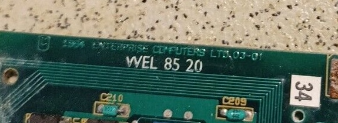
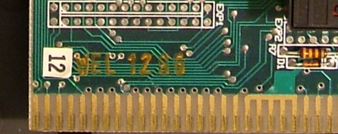
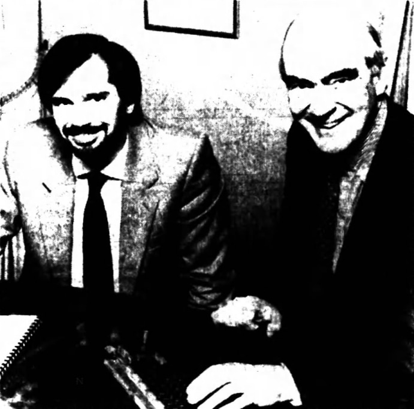

# Welwyn Electronics Ltd.

[https://www.ttelectronics.com](https://www.ttelectronics.com)

Один з виробників материнських плат та карт розширень.

## Історичні подробиці 

 <i>Джон Херрін (праворуч), голова та управляючий директор компанії Welwyn Electronics Ltd., що базується в Бедлінгтоні, разом із Робертом Меджем, технічним директором Enterprise Computers, під час підписання контракту, згідно з яким Welwyn збиратиме найновіший домашній комп'ютер Британії — Enterprise (фото з газети The Journal - Mar 21, 1984)</i>

