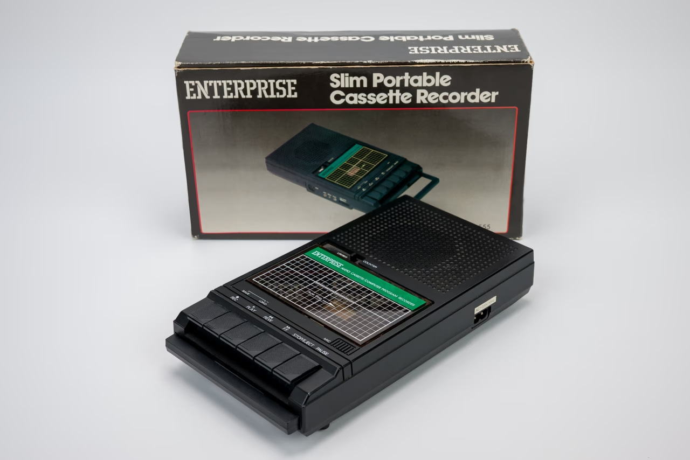
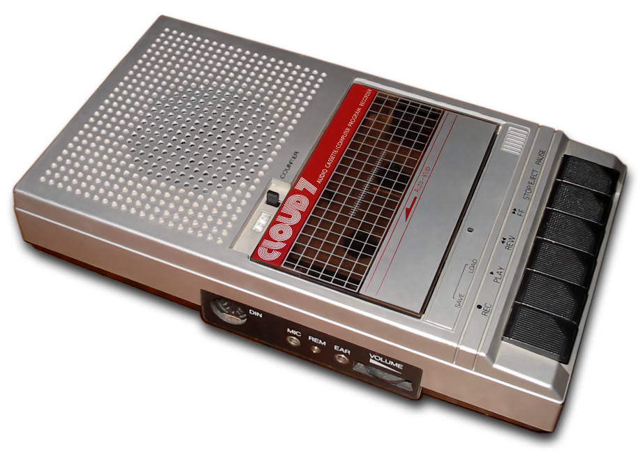
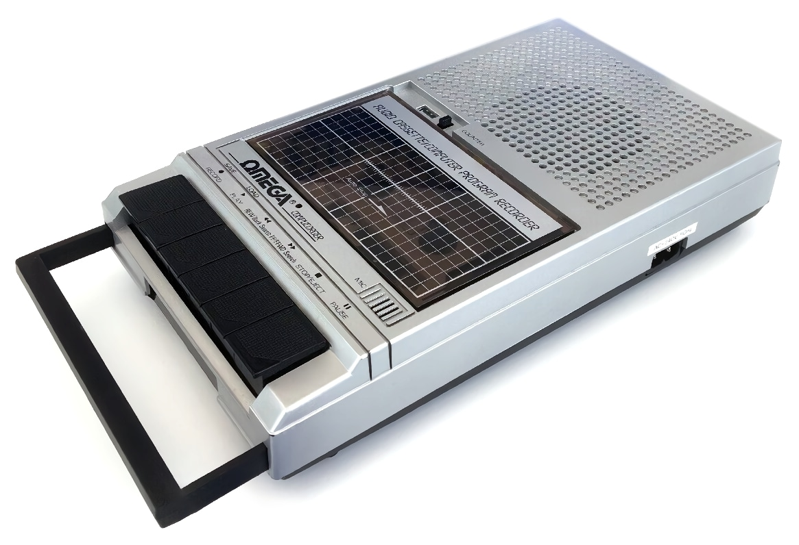

# Касетний накопичувач

Одним з базових та найпоширеніших носіїв даних є стрічкові накопичувачі на основі звичайних компакт-касет.

Для використання з комп'ютерами Ентерпрайз достатньо будь-якого програвача з аудіовиходом, але для комфортнішої роботи краще використовувати пристрої з лічильником та керованою паузою (гніздо REM або REMOTE).

## Enterprise Slim Portable Cassette Recorder

<div style="text-align:center;">
</div>

Невідома (але доволі популярна) OEM модель касетного магнітофона брендованого для Enterprise.

[Основна сторінка](ep-recorder.md)

## Cloud 7 / Omega

Після того як вияснилось що не вийде замовити ще одну партію магнітофонів з логотипом Enterprise компанія [Enterprise Computers GmbH](../../companies/enterprise-computers-gmbh.md) закупила партію аналогічних апаратів які мали назви «Omega» та «Cloud 7».

<div style="text-align:center;">
 
 
</div>

> Цікаво що під назвою Cloud 7 (з ідентичним логотипом) у Англії був [магазин](https://web.archive.org/web/20260125032453/https://britishrecordshoparchive.org/shops/cloud-7/) що займався дистрибуцією музичних записів. 

# Підключення

Підключається накопичувач до роз'ємів [IN/OUT/REM1-2](../connections/pinouts-tape-rem.md) комплектними аудіокабелями, а за їх відсутності можна використати звичайні стерео 3,5 jack - 3,5 jack.

| Enterprise | Магнітофон | Примітка                                                      |
|:----------:|:----------:| ------------------------------------------------------------- |
|     IN     |    EAR     | для завантаження даних                                        |
|    OUT     |    MIC     | для збереження даних                                          |
|   REM 1    |    REM     | для дистанційного керування мотором магнітофона (опціонально) |


# Використання

Основні принципи використання касетних накопичувачів розписані у посібнику по користуванні комп'ютером. У конфігураціях без дискової системи [EXDOS](../../software/ss-exdos.md) файлові операції введення/виведення використовують касетний накопичувач за замовчуванням. У конфігураціях з дисковою системою до касетних накопичувачів можна звертатись за допомогою назви [пристрою](../../programming/system-info/exos-devices/tape.md): `TAPE:назва_файлу`.

Наприклад: 

```
LOAD "TAPE:program.bas"
```
```
SAVE "TAPE-2:sort.bas"
```
```
:COPY master tape:mastermind
```