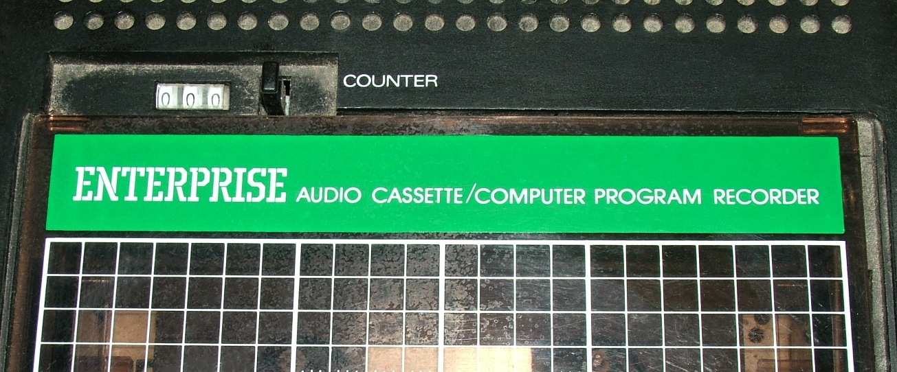
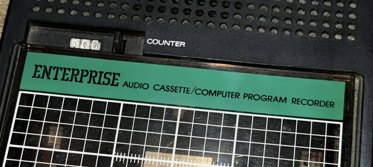
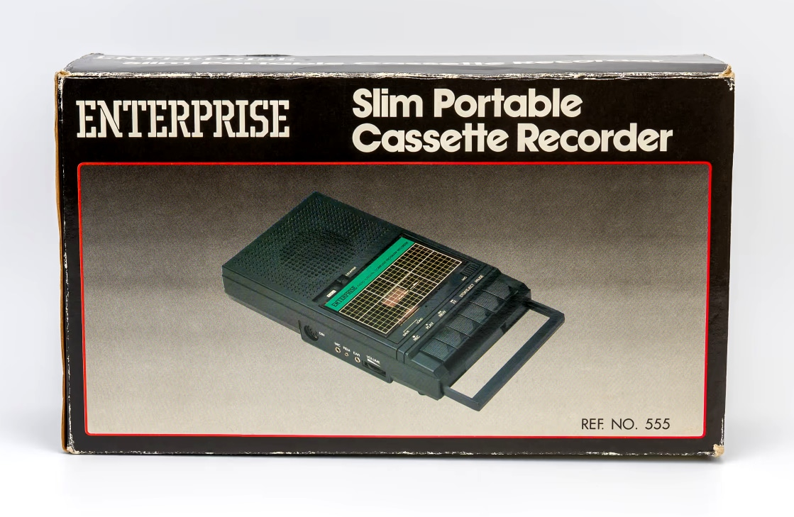
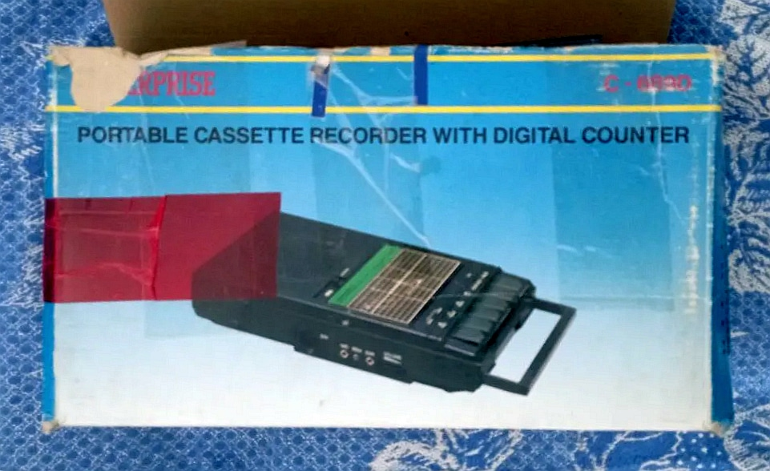

# Enterprise Slim Portable Cassette Recorder

Внутрішній артикул: 06-87   
Модель: 555 / C668  
Країна:  Гонконг

Невідома (але доволі популярна) OEM модель касетного магнітофона брендованого для Enterprise.

Створений на замовлення [Enterprise Computers GmbH](../../companies/enterprise-computers-gmbh.md) орієнтовно у 1987 році (про це [згадує](../../history/qa-werner-lindner1.md) Вернер Лінднер). 

Більше фотографій на сайті [VCM](https://vintagecomputermuseum.com/collection/enterprise-555-recorder/).

Наскільки мені відомо ці магнітофони, не зважаючи на однакові маркування моделей, є різних версій. Я їх розділяю на дві модифікації, в залежності від кольору логотипа на кришці касетного відсіку.

## Білий логотип

Більш поширена версія цієї моделі. Стрічкопротяжний механізм, здається, той самий що встановлювався у комп'ютери Amstrad CPC 464.

## Чорний логотип

У цій версії встановлено один з найпоширеніших стрічкопротяжних механізмів від Tanashin.

## Паковання

Гофрокартонна коробка з пінопластовими вставками.

Найбільш розповсюджена коробка чорного кольору:

Але зрідка може зустрітись і блакитна коробка з більш пізньої партії:

## Технічні характеристики

Максимальна вихідна потужність: **450 мВт**  
Швидкість протяжки стрічки: **4,75 см/сек**  
Система запису: **Підмагнічування постійним струмом** (DC Bias)  
Система стирання: **Стирання постійним струмом** (DC Erase)  
Диапазон відтворюваних частот: **200** — **6 300 Гц**  
Гніздо для навушників: **3,5 мм Jack**  
Гніздо для мікрофона: **3,5 мм Jack**  
Гніздо дистанційного керування: **2,5 мм Jack**  
Розміри, мм: **250** (Д) × **137** (Ш) × **48** (В)  
Вага: **1 кг**  
Живлення від мережі: **220 В змінний струм (AC), 50 Гц**  
Живлення від батарей: **6 В** (4 елементи живлення по 1,5 В типу UM-2 або еквівалент)   

## Документація

[Схема](http://enterprise.iko.hu/schematics/Cassette_Recorder.jpg)

[Посібник користувача](http://enterprise.iko.hu/books/Magnoleiras_angol.pdf)