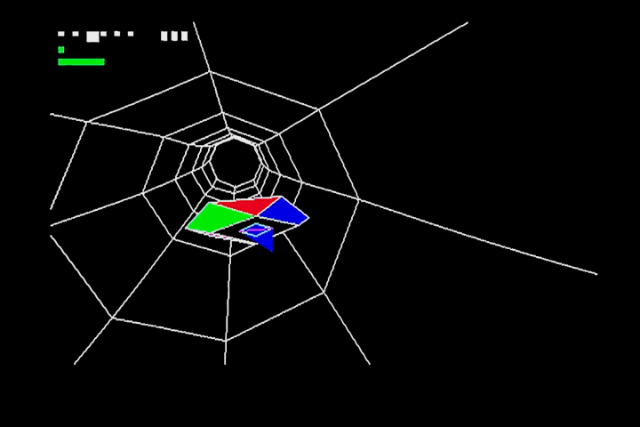

## EGG_D4 (D4h / 212)

Політ через тунель.

(додано у прошивку версії 1.0.6)

Через порт 249 приймаються наступні параметри:

**0**: короткий дротяний тунель  
**1**: середній дротяний тунель   
**2**: довгий дротяний тунель   
**3**: короткий зафарбований тунель  
**4**: середній зафарбований тунель  
**5**: довгий зафарбований тунель  
**240**: спокійна камера  
**241**: рухлива камера  
**242**: "хаотична" камера  
**243**: відобразити космічний корабель  
**244**: приховати космічний корабель  

