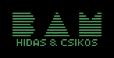
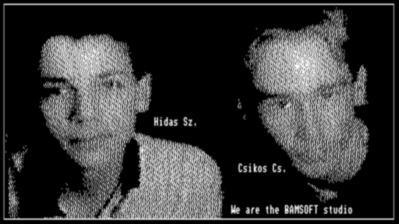

# BAMSoft Studio

Місто: [Мішкольц](https://uk.wikipedia.org/wiki/%D0%9C%D1%96%D1%88%D0%BA%D0%BE%D0%BB%D1%8C%D1%86)  
Роки: **19хх**  
Учасники:  
[Csaba Csikós](csaba-csikos.md)  
[Szilárd Hidas](szilard-hidas.md)  

Команда займалась в основному портуванням ігор з Спектруму. Результат, зазвичай, був доволі якісним, але без проблем не обійшлось: загальна кількість кольорів зменшувалась до 8 (ігнорувався оригінальний біт яскравості) та використовувалась дещо нестандартна таблиця LPT, через що на деяких телевізорах збивалась вертикальна синхронізація. Також вони створили декілька демок та ігор.

Хлопці розбіглись ще у 90-ті і з тих пір не підтримували зв'язок, допоки у 2025 році не приїхали на святкування 40-річного ювілею платформи.

## Демки

BAMDemo 1-2  
Big Demo  
Cauldron Demo

## Ігри

[Labirinth (Tejútvesztő)](../../../sf-games/l/labirinth.md)  
[Western Game](../../../sf-games/w/western-game.md)  
[Wopus](../../../sf-games/w/wopus.md)  

