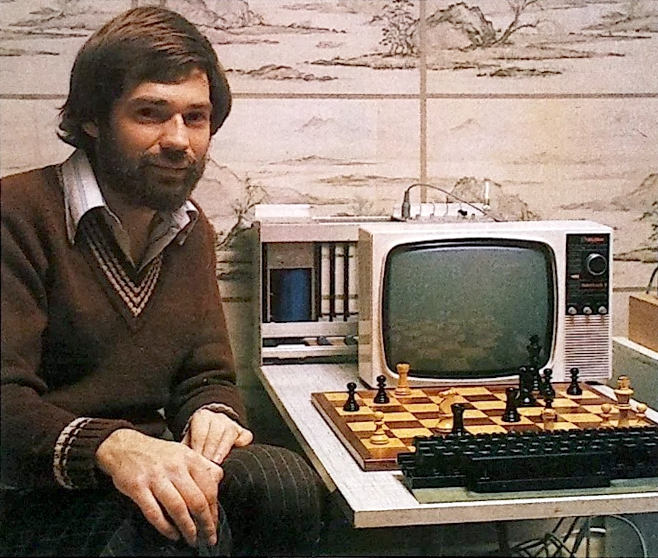

# Mike Johnson

Працював програмістом у [Intelligent Software](../../companies/intelligent-software-ltd.md).  
Створив початкову версію інтерпретатора [IS-BASIC](../../programming/is-basic.md) на мові C.

[https://chessprogramming.org/Mike_Johnson](https://chessprogramming.org/Mike_Johnson)