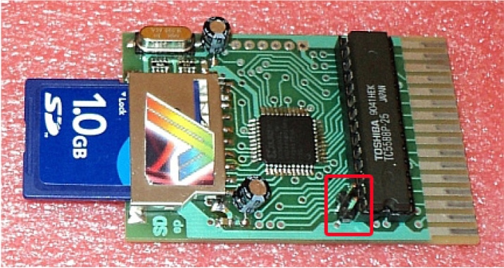
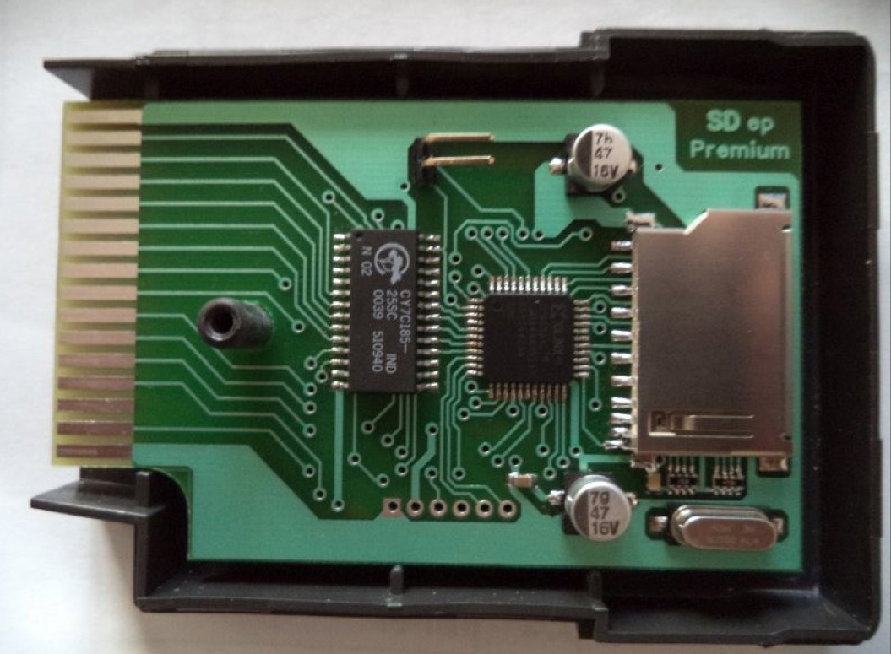
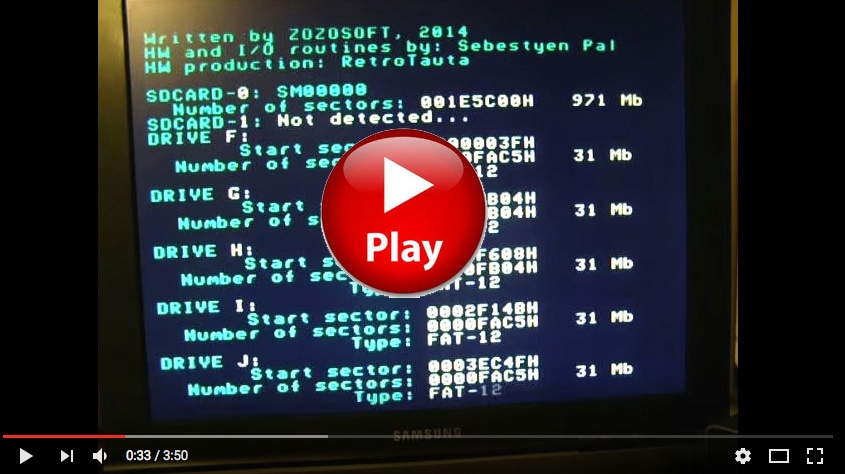

# ENTERPRISE 128 SD Cartridge port adapter

[Оригінал статті](https://magazin.enterpress.news.hu/2015/1/#p=6)

> [!Примітка:]  
> Дана стаття дещо застаріла. Актуальна інформація по адаптеру знаходиться [тут](http://retrotauta.hu/index.php/79-enterprise-128-sd-adapter-premium-quick-start-guide-uk).

----

Írta: [Sárközi Gergely](../../../../peoples/community/szorg.md) (SzörG)



The pre-production of the ENTERPRISE 128 [Cartridge Port SD adapters](../../../../hardware/hd-sd-card-adapter.md) has been completed. This Rev 1.0 version will not be publicly available (only a few pieces were made for development and testing purposes). The “Premium” version can now be ordered, write an email to my address “vortyex at gmail dot com”. The Premium version will be quite different in appearance from the Rev 1.0 version shown here (its PCB will be formed to the original IS-BASIC card shape, in order to fit inside the standard Enterprise cartridge plastic case), and all its components will be SMD surface mount. I personally find the pre-production SD adapter card easy to use (as I have been using it from the beginning), others may need a short guide to help them along.

## The Enterprise 128 Cartridge Port SD Adapter Rev 1.0 - currently takes this form

- The soul of this hardware is a Xilinx CPLD chip.
- It replaces the standard IS-BASIC ROM Cartridge and comes with ZozoSoft’s quick test, [BASIC 2.1](../../../../programming/is-basic.md), [EXDOS 1.4](../../../../software/ss-exdos.md), [WP 2.6](../../../../software/st-wp.md) and its own SDEXT 0.3 firmware, loaded onto a surface mount flash memory IC.
- The flash memory IC content can be changed at any time when working on the ENTERPRISE by using a jumper connector together with the appropriate software.
- The adaptor card includes two SD card slots for microSD and SD cards. These can be used separately or in parallel, as required.
- Cache memory is included on the card.
- As with the EP128 [IDE card](../../../../hardware/exdos/hd-ide.md), theSD Adapter card’s firmware is currently compatible with FAT12. This allows you to manage partitions that are 32Mb in size.
- EXDOS with FAT16 compatibility is actually under development. In the future you should be able to quickly and easily upgrade your SD adaptor card to make use of this.

## Start-up

Turn the ENTERPRISE computer off from the power supply. Remove any existing ROM cartridge from the ROM BAY, and then gently insert the adapter card into its place as indicated in the photo below (with the SD card slot
upwards and the soldered side of the card facing down). Make sure that you slide the card straight into the computer’s motherboard edge connector. If the card misaligns, the circuitry will not engage correctly and you will have to remove and insert the card all over again. Important: On no account remove or insert the adapter card while the ENTERPRISE is still powered up, as this may damage the computer, the adapter or even both!

Unfortunately [EXDOS 1.4](../../../../software/ss-exdos.md) is not yet compatible with FAT16 file system so first of all it is necessary to use a suitable external device (e.g. a PC using “partition Guru” software) to transfer a Virtual Disk File to any SD card you intend to use. The partition manager software slowly creates six 32Mb partitions, this takes about 15 minutes. (If anyone has a faster, more reliable, or better way of doing this, please let me know!) Use the DISK sub-menu ‘OPEN VIRTUAL DISK FILE’ function to open the Virtual Hard Disk (VHD) file. Write the six FAT12 partitions to your SD card using the TOOLS submenu ‘CLONE DISK TOOLS’ feature. Now, any files can be copied to the modified partitions of the SD card, the ENTERPRISE 128 can load these files after inserting it into the adapter’s SD card.

Currently, EXDOS does not automatically recognise the adaptor card, so it is necessary to insert the card into the ROM BAY of the ENTERPRISE before powering up the computer. If you need to use the card on-the-fly, always turn the computer’s power supply off first, before you insert the card. Note: it is no use pressing the computer’s red **Reset** button several times, as this does not fully initiate the ENTERPRISE booting process. There is no “on/off” button on the ENTERPRISE, so you must either remove the power cable from the back of the computer or turn it off at the mains supply plug end. The ENTERPRISE will now boot up with a ZozoSoft quick-test, then the machine will list all the available SD card / cards partitions, sectors and size of the drive letter assigned to them. During this test, or whenever the driver listings are scrolling, you may want to examine the display. If so, (using the old-style PC key method) press the **Pause** key (German keyboard) or the **Hold** key (English keyboard). The computer will remain in this mode until you press that key again. If pressed during the ZozoSoft quick-test, you can notice that in the top right hand corner of the screen the word **Pause** appears, and a listing of the drivers in the top-left corner. **Hold** informs you that the computer is still running (i.e. it is waiting for you, it has not frozen). In principle, this sleight of hand will be no longer necessary with FAT16 compatible EXDOS, because you might be able to handle the whole content on only a 2GB partition (or on some less ones, if required). Pressing any keyboard key causes the usual flashing colours ENTERPRISE default screen to appear. After pressing any other key the BASIC command interpreter logs on again (who later changed the content of the flash IC, something else can be loaded according to the upgraded content: [IS-DOS](../../../../software/ss-is-dos.md), [EPDOS](../../../../software/sf-epdos.md), [FORTH](../../../../programming/is-forth.md) etc.).



## A short ENTERPRISE 128 and EXDOS guide

A rudimentary file manager program is now available in the new version of EXDOS. It is easy to use, type the `:FILE` command. The search bar moves up and down using the internal joystick, you can change the folder and select files with **Enter**. All executable files can be run with **Enter**. The partitions can be selected by typing a drive letter (default drive is **F:** Drive, and **G:**, **H:**, **I:**, **J:**, **K:**, etc.). 

I shall not repeat the complete [EXDOS manual](../../../../manuals/ss-exdos-manual-en.md) here; it is enough to say the adapter works with standard EXDOS commands. So I just mention a few simple instructions that you will definitely need. Type the `:EXDOS` command to enter the [EXDOS command shell](../../../../manuals/dos-commands/cmd-exdos.md). Anyone who is looking for the colon key on the German keyboard should press **Ä** instead. Of course, within BASIC an extension command can be issued (bypassing the EXDOS shell), you need only to use the colon sign in front of each command. Firtst type `HELP` (the EXDOS shell prompt puts you the necessary colon sign), this lists all the currently available built-in programs on your ENTERPRISE system. Normally this will be the machine’s response:

```
:HELP
```
```
SDEXT version 0.1
EXDOS version 1.4
BASIC Version 2.1 (currently the English BASIC is available)
WP version 2.6 (SUPERWP)
WP version 2.1 (programmed on the motherboard’s ROM).
```

Built-in programs from this list (which may include [Pascal](../../../../programming/hisoft-pascal.md), [Forth](../../../../programming/is-forth.md), [IS-DOS](../../../../software/ss-is-dos.md), Assembly Language etc.) can be called up by a command line instruction (Note: SDEXT is the software driver for the SD adapter itself, so it makes no sense to call this). For example, to call the [Super Word Processor](../../../../software/st-wp.md) (loaded version 2.6) from inside BASIC - just type the `:WP` command. From within EXDOS to enter the text editor, type `WP` without using a colon. Of course, the usual ENTERPRISE function keys may also be used for this purpose. From the BASIC, pressing **Shift**+**F8** allows you to exit to text editor. From the WP - press **F8** to enter any EXDOS commands, or press **Enter** to exit into the EXDOS command prompt mode. From within EXDOS type a `:BASIC` command to exit into the BASIC shell.

Go to the EXDOS command shell and experiment with using the drives. First select one of the drives, enter the drive’s designated letter followed by a colon. For example, I linked a VDF file that contains the following drives „F: GAMES_1 (games libraries 00-H)”, „G: GAMES_2 (games libraries I-R)”, „H: GAMES_3 (games libraries S-Z, CPC games)”, „I: DEMOS (more 100 demo, not counted)”, „J: Media (music and video players)”, „K: UTIL (Util, IS_DOS)” these you can choose.

```
I:
```

It lists the contents of this drive, as I said, a lot of this library will be on the drive.

```
DIR
```
```
Volume in drive I: DEMO is
Directory of I: \
3D_SHOW
ALPHA
AMIGABLL
ARTAN etc. ...
```

The listing can be stopped from scrolling by pressing the pause key (**Pause** / **Hold**), or else you can press the **Stop** key instead. If so, the `*** STOP key pressed` EXDOS wording appears. You may then change into another directory of your choice, for example, in SMALLDEM.

```
CD SMALLDEM
```

You can list the [DIR](../../../../manuals/dos-commands/cmd-dir.md) command. If we look at the results we can see that we get information in files level too. If we find an executable file, it will load up with the [LOAD](../../../../manuals/dos-commands/cmd-load.md) command.

```
LOAD SMALL.COM
```

You load this example, the famous and beloved Small Demo, sit back and relax; the adapter performs surprisingly fast, even when compared to a floppy drive. When you are bored with this demo you can do a reset. After exiting you can see the strange thing that the computer has remembered where in the hierarchy volume you were before. If you want to go to the root of the current drive, enter the CD command followed by the correct drive letter.

```
CD I:\
```

The backslash symbol on the German keyboard can be found on the <b><sup>&lt;</sup><sub>&gt;</sub></b> key.

[](https://magazin.enterpress.news.hu/2015/1/files/pageConfig/Enterprise%20128%20SD%20Adapter%20Premium.mp4)

So now you have sufficient knowledge to use EXDOS in a basic level, at least good enough to load up stored programs onto your computer. Of course, we look forward to a file manager program and the Enterprise conversion of a few similar Videoton TV Computer software (the Videoton TV Computer is a Hungarian ENTERPRISE clone, based on the early license of ENTERPRISE Computer)! :-)

## How to overwrite the content of the flash memory IC  

The flash memory IC is set to read-only by default. If you want to change the content of the IC itself you should turn the computer off, remove the card and then insert a jumper connector as shown in the picture below, with a red circle. Doing so will now allow you to write to the flash memory IC.

The program designed for this purpose and the right chosen ROM files should now be copied on the SD card into one partition then start it in the ENTERPRISE. Writing, checking the contents of the flash will be done. If no error is caused, the memory space (that was used by the machine so far) will be overwritten. So, in principle, the amendment cannot mess up the flash (I have managed to change the content without any mistakes), but if a power outage should occur when overwriting and something goes wrong, the adapter can be re-programmed, of course.

----

[Основна сторінка адаптера SD-card](../../../../hardware/hd-sd-card-adapter.md)
