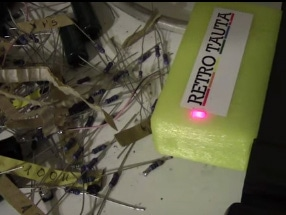
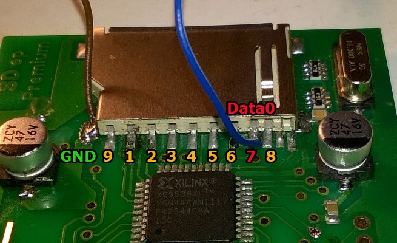

# Enterprise 128 SD adapter premium activity LED

[Оригінал статті](https://magazin.enterpress.news.hu/2017/1/#p=7)

> [!Примітка:]  
> Модифікація має відношення лише до ранньої версії адаптера.

----

Írta: [Sárközi Gergely](../../../../peoples/community/szorg.md) (SzörG)

This is a problem, the SD Adapter Premium have no activity indicator LED. Is an very easy hack, let‘s do it one. 

Part list: 1x LED, 1x 220 Ohm resistor, 2x 5cm long wire 

To do: Solder the 220 Ohm resistor to positive leg of LED (the longer leg of this part), and the wire too. Solder with the wire to the PIN7 of the SD Card slot. Then solder the another wire to the negative leg of LED, and solder the wire to the GND. Use two short heat shrink tube on soldered parts, it prevents a short circuits. Place it the LED in the plastic case, and turn on the computer and try it

----

[Основна сторінка адаптера SD-card](../../../../hardware/hd-sd-card-adapter.md)
