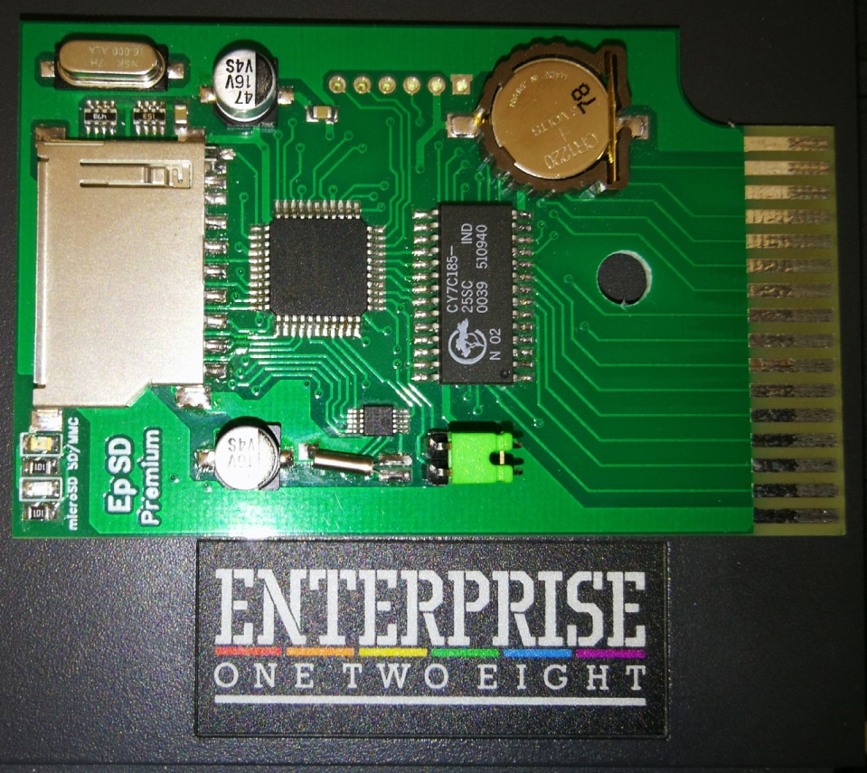
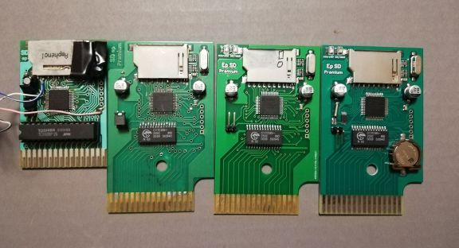

# Enterprise SD Premium rev. 4. (dátum- és időkezeléssel)

[Оригінал статті](https://magazin.enterpress.news.hu/2019/1-2/#p=5)

----

Írta: [Sárközi Gergely](../../../../peoples/community/szorg.md) (SzörG)

**Szergely műhelyében elkészült az SD Premium rev. 4-es változata!**

Ez a verzió már RTC-vel, azaz dátum kezeléssel is rendelkezik, mint a képen látható, a kártyán egy elem is helyet kapott, így a dátum és idő tárolódik a kártyán.

A szoftvert Zozo írja hozzá (a ZozoTools-ból az órakártya kezelés át lesz helyezve az SD kártyára).

Valószínű, hogy az új SD kártyával „bevárják” a Bruce Tanner és Zozo által készített EXDOS 3.0 változatát, melynek újdonságairól a következő számban részletesebben is olvashattok.

## Enterprise SD evolúció (2014–2018.)

----

[Основна сторінка адаптера SD-card](../../../../hardware/hd-sd-card-adapter.md)
