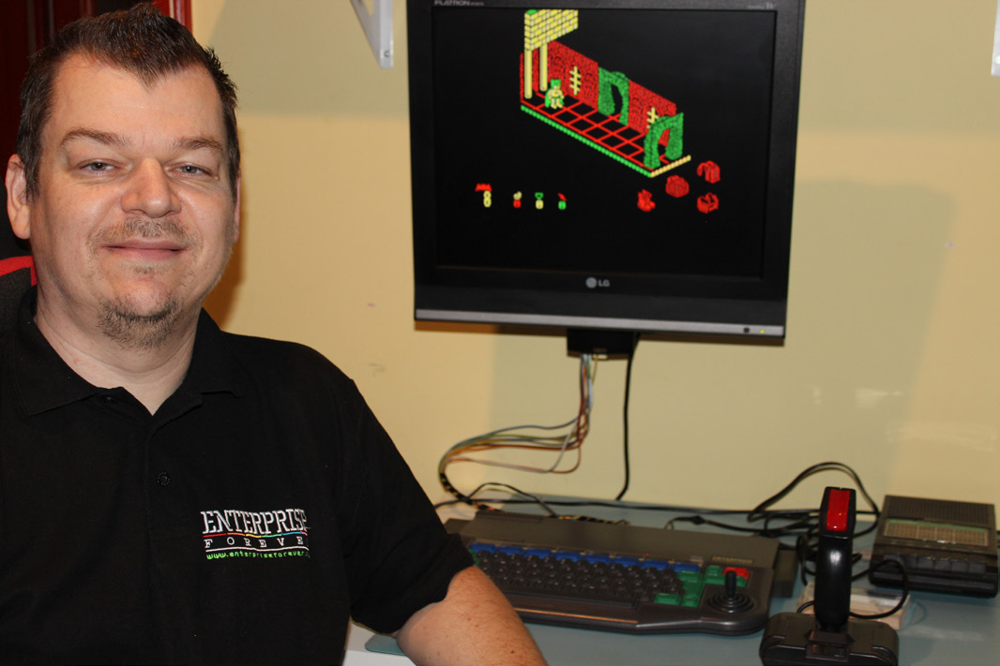
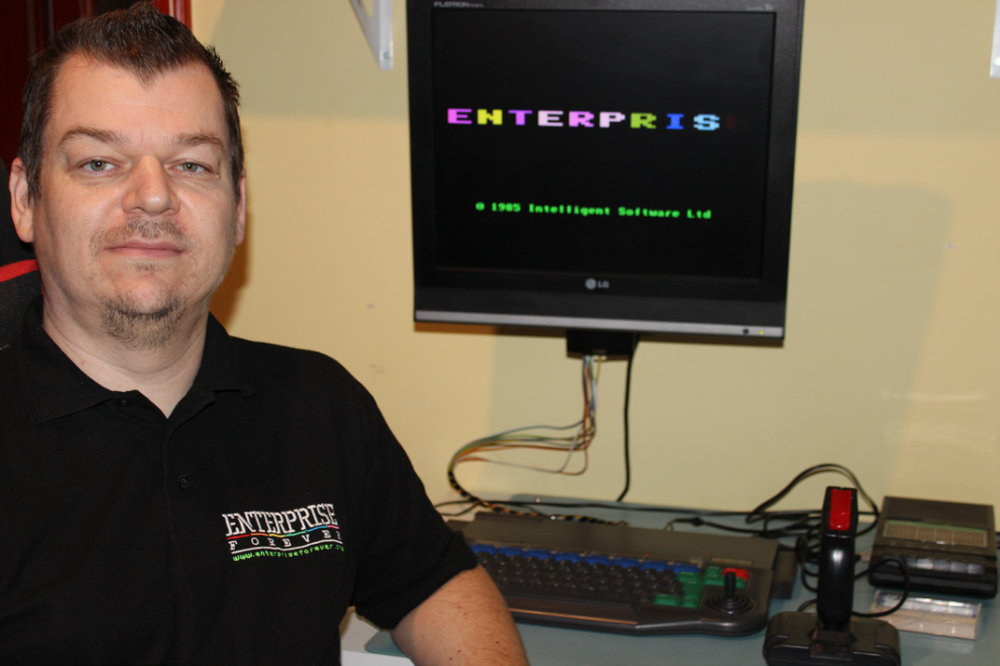

# Enterprise Forever: Interjú [Lukács Árpáddal (Mr.Prise)](../../../../peoples/community/mrprise.md)

[Оригінал статті](http://magazin.enterpress.news.hu/2024/4-6/#p=3)

Írta: [Bodnár Tamás](../../../../peoples/community/szipucsu.md) (Szipucsu)

**Talán senkinek nem kell bemutatni Mr.Prise-t, aki az Enterprise Forever fórumot létrehozta és üzemelteti, immár kb. 18 éve, amit ezúton is köszönünk neki mindannyiunk nevében. De ki is ő valójában? Most kicsit többet is megtudhatunk Lukács Árpád személyéről.**

#### Hogyan kerültél kapcsolatba az Enterprise számítógéppel? Milyen élményeid voltak vele?

Általános iskolások voltunk az öcsémmel, amikor a család barátja, Balla Anti vett egy Enterprise-t. Elhívott minket, hogy megmutassa nekünk, mert sejtette, hogy fog nekünk tetszeni, mivel ő is odáig volt érte. A gép színes TV-re volt kötve és azon mutatott meg néhány „eredeti” EP játékot, magnóról betöltve: [Batman](../../../../sf-games/b/batman.md), [Sorcery](../../../../sf-games/s/sorcery.md), [Wriggler](../../../../sf-games/w/wriggler.md), [Airwolf](../../../../sf-games/a/airwolf1.md), [Nodes of Yesod](../../../../sf-games/n/nodes-of-yesod-zx.md).

Teljesen le voltunk nyűgözve, hogy milyen szép a grafika, milyen színes, mert még sosem láttunk előtte ilyet. Addig a piacos TV játék számított nálunk a legmodernebb hardvernek. Az Enterprise ahhoz képest csúcstechnika volt. A hangeffektek, a zenék, de a gép kinézete is nagyon tetszett nekünk.

Ezután persze még többet jártunk hozzá, szó szerint nyúztuk a gépét. Ha hagyta volna, egész nap játszottunk volna vele. Időnként kizavart minket az utcára, hogy futkározzunk. Egyik alkalommal ott hagyott minket játszani a Wriggler-rel, aminek az lett vége, hogy az addig tökéletesen működő külső joystick egyszer csak már nem működött jobbra. Nekünk persze fogalmunk sem volt, hogy egyáltalán el tud romlani és azt pláne nem gondoltuk, hogy mi rontottuk el. Szétszerelte és kiderült, hogy a fém lapka tört el benne. Érthető módon nem örült ennek és mi is nagyon rosszul éreztük magunkat miatta. Amennyire emlékszem, rendeltetésszerűen használtuk és egy joystick-gyilkos játékkal sem játszottunk, mint amilyen pl. a [19 Boot Camp](../../../../sf-games/0/19-part1-boot-camp-zx.md). Egy lapos elem érintkezőjével sikerült megjavítania. Utána már nagyon óvatosan mertük csak használni.

Ennek ellenére később kölcsön is adta a gépét, de magnó nélkül, mert azt vinnie kellett másolgatni játékokat, ha jól emlékszem. Szerencsére nem maradtunk játék nélkül, mert reggel nálunk betöltötte a gépbe a Sorcery-t és azzal játszhattunk egész nap. Az öcsémmel felváltva futottunk neki és egyre jobban ment, annyira, hogy sikerült végig is játszani, mire délután jött a gépért. Alig akarta elhinni, hogy eljutottunk a végére. Később, a szüleinknek hála, saját gépünk is lett, és ahogy tanulgattam a [BASIC](../../../../programming/is-basic.md)-et, mutattam neki, hogy miket tudok, pl. hogy hogyan lehet a betűk megjelenítését módosítani. Sajnos a közös Enterprise rajongói korszakunknak végett vetett az autóbalesete, amelyben az életét vesztette.

#### Mire használtad a gépet?

Eleinte csak játékra, de a gépkönyv alapján hamar elkezdtem a BASIC-kel is ismerkedni. Azután amikor értettem a különbséget a BASIC és a gépi kódú programok között, elkezdett érdekelni, hogy hogyan készülnek a gépi kódú játékok. Akkor még nem volt Internet, semmit sem tudtam az assembly-ről vagy a gépi kódról, csak annyit, hogy azzal nagyon jó dolgokat lehet csinálni.

Teljesen véletlenül láttam meg a postán egy rakás magazin és újság között az [Enterpress](../../pr-enterpress-hu.md) első számát. Ha nem hasonlított volna a logója az Enterprise-éra, akkor lehet, hogy észre sem veszem. Rögtön megvettem és állandó előfizetője is lettem. Az Enterpress tele volt olyan ismeretekkel, amelyeket akkor nem tudtam volna máshonnan beszerezni. Nagyon örültem neki. Különösen az assembly programozásba ástam bele magamat, de minden más is érdekelt. Egyre többet foglalkoztam a géppel.

Egy disassembler / monitor programot is elkezdtem csinálni, illetve szakközépiskolában, amikor számítástechnika órára be kellett mutatni egy saját fejlesztésű programot, akkor egy IS-BASIC-ben írt nyilvántartó programot mutattam be. Az iskolában nem volt Enterprise, így a gépet is vinnem kellett a bemutatóhoz. Elég kalandos volt az az út, ugyanis a szakközépiskola Debrecenben volt és oda jártam be busszal egy 60 kilométerre lévő településről. Több mint 1 óra volt az út, amit minden nap kétszer tettem meg busszal. Egy nagy szatyorban vittem be a gépet az iskolába, hazafelé pedig olyan hirtelen kapott el egy zápor a megállóba menet, hogy teljesen eláztam. Szerencsére a gépnek nem lett semmi baja és a bemutatóra is ötöst kaptam.

#### Megvan még a géped?

Igen, de szakközépiskolás koromban volt utoljára bekapcsolva, 1992 körül. Utána pedig lett PC-nk és onnantól kezdve azzal foglalkoztunk. Játszottunk is rajta, de az Enterprise-nak köszönhetően addigra már annyira megszerettem a programozást, hogy a legtöbb időt arra fordítottam, de már PC-n. Megismerkedtem a C-vel, az x86 assembly-val, aztán lett Internetünk és természetesen rákerestem az Enterprise-ra is. Így találtam meg az első komolyabbnak mondható Enterprise-os weboldalt is, az [Enterprise Repository](https://web.archive.org/web/20050212125604/http://www.mumm.ac.be/~cammejpm/enterprise.html)-t is, amelyet Jean-Pierre Malisse készített.

Utána akadtam rá az első Enterprise emulátorra is. Előtte azt sem tudtam, mi az az emulátor. Úgy tűnt, hogy azt az emulátort már nem fejleszti senki, így elhatároztam, hogy csinálok egy sajátot. Igaz, hogy akkor még azt sem tudtam, mi fán terem az emuláció, de az Internetnek köszönhetően találtam egy amolyan “Hogyan csináljunk emulátort?” leírást és az alapján kezdtem el 1998 körül.

Eleinte DOS alatt fejlesztettem C-ben. A Z80 emuláció assembly-vel volt megoldva, amit egy Z80-as könyv és az EXOS műszaki leírás alapján csináltam, úgy, hogy közben igazi gép nem is volt a közelemben. Ennek az volt az oka, hogy elköltöztünk otthonról, az Enterprise pedig a családi ház padlásán maradt nagyon sokáig.

Közben megismerkedtem a Linux-szal és nagyon megkedveltem, így azon folytattam a fejlesztést. Sok minden működött már akkor is benne, hang viszont egyáltalán nem volt. Azzal csak akkor akartam foglalkozni, ha már minden más olyan, amilyennek szerettem volna. Odáig viszont még nem jutottam el. Újra is kezdtem néhányszor, pl. D-ben, de a legújabb verzió már Rust-ban készül.

Így utólag visszatekintve, az emulátorom inkább tűnik egy tanuló, gyakorló projektnek mint egy komoly projektnek. Sokat tanultam közben a programozással kapcsolatban, illetve az Enterprise és a Z80 működéséről. Amikor elkezdtem, akkor azt reméltem, hogy egy olyan szuper emulátort fogok csinálni, amit mindenki nagy örömmel fog majd használni. Aztán teltek az évek és hiába haladtam vele, sosem éreztem úgy, hogy készen van, használható. Nem azért, mert nem volt jó ami készen volt, hanem mert mindig volt újabb ötlet amit még meg akartam csinálni, mielőtt megmutatom bárkinek.

Közben megjelent [Varga István](../../../../peoples/community/istvanv.md) [EP128Emu](../../../../emulators/em-ep128emu.md)-ja, és az lett az az Enterprise emulátor, amit mindenki használ, én is, ha EP játékkal szeretnék játszani.

Ennek ellenére, még nem adtam fel a projektet, szeretek rajta dolgozni és szeretném egyszer befejezni. Mostanra azonban már annyi tervem és félkész projektem van, hogy nem tudom, mit fogok tudni közülük tényleg be is fejezni és főleg mikor. Amíg fiatal az ember, végtelennek tűnő idő és energia van mindenre, de felnőttként, munka és család mellett már más a helyzet.

#### Volt a gépedhez valamilyen bővítőd?

Csak magnónk volt. Valószínűleg ezért szeretem még most is a töltés csipogásának hangját. Gyerekként a legtöbb játékot a töltéshang csipogása alapján megismertük. Később a [Haluska László](../../../../peoples/community/hsoft.md) által készített TPT ROM-mal használtam a magnót.

#### A 90-es években jártál Enterprise Klubba? Tartottad a kapcsolatot más felhasználókkal?

Nem jártam és nem ismertem senkit személyesen. Haluska Lászlóval leveleztem assembly programozással kapcsolatban, aki nagyon barátságos és segítőkész volt. Mindig nagyon részletesen válaszolt a kérdéseimre.

#### Mi a civil foglalkozásod?

Az elmúlt 15-20 évben szabadúszó fejlesztőként dolgozom, elsősorban a Ruby on Rails keretrendszerrel, de néha PHP-vel is. Előtte egy multi cégnél voltam többek között C# fejlesztő.

#### 2005 decemberétől működik az Enterprise Forever fórum. Honnan jött az ötlet, hogy megcsináld ezt a fórumot?

Az ősidőkben volt egy Enterprise fórum az Index-en. Akkoriban kezdtem el webes dolgokkal foglalkozni és így adta magát, hogy milyen jó lenne egy saját Enterprise fórum. Az oda járó törzstagoknak tetszett az ötlet. Nem sokkal később el is indult a fórum első PHPBB alapú verziója az enterpriseforever.org címen.

#### Hogyan érted el, hogy az Enterprise szerelmesei megtalálják a fórumot és regisztráljanak?

Igazából teljesen természetes módon történt és történik, de a kezdetekben biztos sokat segített, hogy a régi Index-es fórum aktív tagjai Zozosoft-tal az élen azonnal átköltöztek az új fórumra, amint beindult. Az indulás után talán egyszer-kétszer csináltam online hirdetést a legnépszerűbb keresőben, de ha jól emlékszem, nem eredményezett érezhetően több regisztrációt, ezért fel is hagytam a reklámozással.

#### Mennyi energiádba kerül a fórumot üzemeltetni és fenntartani? Voltak esetleg nehezebb időszakok?

Nem fáradság vele foglalkozni, szívesen foglalkozom vele. Vannak rendszeres feladatok, mint pl. a fórum motor frissítése. Mivel elég sok külső módosítást is használunk, a frissítés nem csak annyiból áll, hogy feltöltöm a szerverre a fórum újabb verzióját és rögtön megy minden elsőre. Mindig meg kell nézni, hogy nem romlott-e el valami a frissítéstől. Időközben volt egy elég nagy verzióváltás 2.0.x-ről 2.1.x-re, ami nagyon sok mindent megváltoztatott. Pl. a csatolt file-ok másként vannak már tárolva, ezért azok is módosulnak a frissítés közben. Van olyan módosítás, ami már nem is működik az új verzióval. Van olyan, amire már nem is lesz szükség és van olyan, amit nekem kell módosítani, hogy működjön. Ezt a nagyobb frissítést még nem fejeztem be.

A legnehezebb talán az volt, amikor az első és eredeti domaint, az enterpriseforever.org-ot elvesztettem a szolgáltató hibájából. Az új tulajdonos egy domain kereskedő volt, aki több mint 1000 Eurót szeretett volna érte kapni. A fizetés helyett inkább regisztráltam az enterpriseforever. com-ot és utána ezen a címen volt elérhető a fórum. Szerencsére rajtam kívül valószínűleg senki sem érdeklődött a domain iránt ennél a domain neppernél, így egy idő után hagyta lejárni és akkor sikerült újra megszereznem. A .com-ot is megtartottam, így most mindkét címen elérhető a fórum.

A domain elvesztése a póló projekt miatt is kellemetlen volt, ugyanis azon az .org-os cím szerepelt.

A másik problémát a botok okozták. Eleinte nyílt regisztráció volt a fórumon, de ahogy egyre népszerűbb lett a fórum, megtaláltak minket a botok is. Ezek különféle reklámokat próbáltak beküldeni a fórumra. Ennek elég gyorsan sikerült véget vetni azzal, hogy letiltottam a nyílt regisztrációt és azóta is kézzel regisztrálok mindenkit, aki ír egy emailt a regisztrációs oldalon olvasható e-mail címre. A fórum tartalmának karbantartásában, moderálásában segítségemre van néhány lelkes és aktív fórumozó, akiknek innen is köszönöm a segítségüket!

#### Megéri a fórumot üzemeltetni?

Anyagi szempontból nem, de nem is ezért csinálom. Az én „fizettségem” az, hogy elmondhatom, hogy amenynyire én tudom, a fórumunk az egyetlen, legrégebbi Enterprise fórum az egész világon, ahol a gép hazai nagy öregjei és a gép fejlesztésében részt vevő szakemberek együtt tudnak beszélgetni velünk mezei felhasználókkal, akik csak használjuk és csodáljuk az általuk fejlesztett hardvereket és programokat.

Persze nagyon örülnék, ha annyi támogatás vagy bevétel származna a fórumból, hogy munka helyett, állandóan tudjak vele foglalkozni. Azonban realisztikusan erre túl sok esély nincs, főleg, hogy semmilyen reklám és tagdíj sincs az oldalon. Egy időben kísérleteztem reklámokkal, de az abból származó bevétel nagyon kevés volt. A reklámok pedig zavaróak voltak, illetve rontották a fórum kinézetét, ezért felhagytam velük és azóta sincsenek reklámok. Jelenleg csak a tagoktól kapott önkéntes anyagi támogatás az egyetlen bevételi forrás a fórumból. Ezúton is szeretném megköszönni mindenkinek, aki anyagilag támogatja fórumot!

#### Anyagilag nem visz el sokat?

A fórumot a speciális témája miatt nem fenyegeti az a veszély, hogy olyan sok látogatója legyen, aminek a kiszolgálására atomerőműre lenne szükség. Persze a domainek, a tárhely, mind pénzbe kerül, de nem okoz gondot ezeket fizetni. Ráadásul vannak olyan fórumozók, akik rendszeresen anyagilag is támogatják a fórum működését, amire már elég régóta van lehetőség.

Néha megkapom kritikaként régi fórumozóktól, hogy nem „reklámozom” eléggé a támogatás lehetőségét. Ez valószínűleg azért lehet, mert nekem ez kényes téma. Nem szeretném, ha úgy tűnne, hogy a fórum létezéséhez szükségem van anyagi segítségre. Ez sosem volt így és remélem, a jövőben sem fogok erre rászorulni. Ennek ellenére persze a támogatásoknak mindig örülök. A támogatást motiválandó találtam ki a „Támogatásért cserébe weboldalt” lehetőséget, aminek az a lényege, hogy rendszeres támogatásért weboldalak hosztolását tudom vállalni ill. szakmai segítséget tudok adni, karbantartást, javítást, akinek esetleg erre lenne szüksége.

#### Az elején még nem úgy nézett ki a fórum, mint most. Meg tudnád esetleg nevezni a főbb állomásokat a fejlesztésben?

A fórum első verziója PHPBB-vel működött, aztán később SMF-re lett cserélve, ami szintén egy PHP alapú fórum motor. A fórum első kinézete az én „művem” volt, amit az Enterprise színei, billentyűi, egyedi jellemzői (pl magnós betöltés jelző) és a WP megjelenése „ihletett”. Mivel a grafikai tervezéshez nem értettem, ezért azt hittem, elég, ha Enterprise-os dolgokat összepakolok és az „szép” lesz. Szerencsére senki sem panaszkodott, de azért sejtettem, hogy biztos szebb lenne, ha valaki olyan tervezte volna, akinek érzéke is van hozzá. Később sikerült találnom egy designert, akinek a fórum jelenlegi kinézetét köszönhetjük.

#### Vannak egyéb terveid a fórummal kapcsolatban a jövőben? Gondolkozol esetleg az oldal bővítésén, vagy hasonlón?

Igen, vannak tervek. Kisebbek és nagyobbak egyaránt. Egy részéről már tettem említést a fórumon, de sok olyan van, ami mindenki számára meglepetés lesz majd, ezért ezekről nem szeretnék elárulni egyelőre semmit.

#### Tervezel esetleg programokat írni Enterprise-ra?

Nincsenek ilyen terveim.

***Köszönjük a beszélgetést! A fórum üzemeltetéséhez további jókedvet és egészséget kívánunk!***

