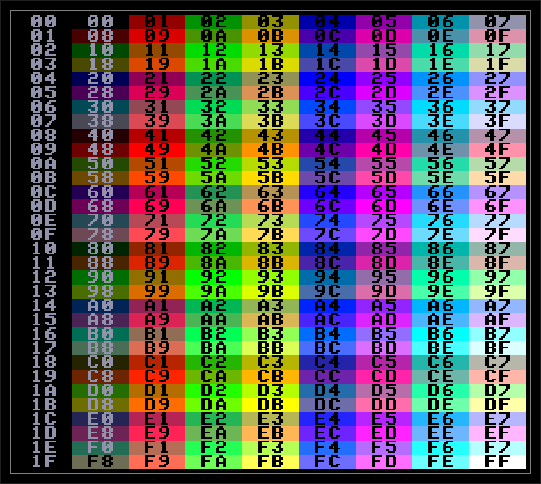

# Загальна палітра кольорів комп'ютера

[Інтерактивна таблиця підбору кольорів](http://ep.lgb.hu/colors.html) [(дзеркало)](https://ep128.hu/Ep_Konyv/EP_colours.html)

Ліва колонка - номер [BIAS](nick/bias.md) (для запису у [128](ports/port128.md) порт Nick)

## Локальна палітра кольорів

Локальна палітра кольорів містить 16 індексів які використовуються для визначення кольорів у більшості відеорежимів і [зовнішнього відеовходу](nick/ext-colours.md).

Для усіх відеорежимів можна задавати до 8 унікальних кольорів (кольори 0-7 які записуються у [LPT](nick/lpt.md)) та загальний для всього екрану [BIAS](nick/bias.md) який визначає кольори 8-15.

| № індексу | можливі значення  |                          |
|:---------:|:-----------------:| ------------------------ |
|     0     |       0-255       |                          |
|     1     |       0-255       |                          |
|     2     |       0-255       |                          |
|     3     |       0-255       |                          |
|     4     |       0-255       |                          |
|     5     |       0-255       |                          |
|     6     |       0-255       |                          |
|     7     |       0-255       |                          |
|     8     | BIAS_NUM \* 8 + 0 | 32 відтінки темносірого  |
|     9     | BIAS_NUM \* 8 + 1 | 32 відтінки червоного    |
|    10     | BIAS_NUM \* 8 + 2 | 32 відтінки зеленого     |
|    11     | BIAS_NUM \* 8 + 3 | 32 відтінки жовтого      |
|    12     | BIAS_NUM \* 8 + 4 | 32 відтінки синього      |
|    13     | BIAS_NUM \* 8 + 5 | 32 відтінки фіолетового  |
|    14     | BIAS_NUM \* 8 + 6 | 32 відтінки блакитного   |
|    15     | BIAS_NUM \* 8 + 7 | 32 відтінки світлосірого |

BIAS_NUM = 0-31 (визначається для усього екрану)

# Підбір кольорів з інших платформ

[ZX Spectrum](../conv-zx/zx-palette.md)  
[Amstrad CPC](../conv-cpc/cpc-palette.md)  
[Pico-8](../conv-pico8/snpico-colours.md)   
[MSX](../conv-msx/msx-palette.md)  

# Визначення кольорів

Чіп Nick генерує байти кольорів для кожного пікселя на екрані в залежності від значень регистрів відео режиму, режиму кольору та палітри. Ці 8-бітні значення кольору перетворюються у окремі сигнали червоного, зеленого та синього, які подаються на роз'єм монітору. Звідти вони подаються на PAL-кодер і UHF-модулятор для перетворення в сигнал, що підходить для телебачення.  
З **8** біт на червоний та зелений кольори виділено по **3** біти, а на синій колір лише **2**, тому червоний та зелений можуть мати **8** відтінків, а синій – **4**. (**G**=зелений, **R**=червоний, **B**=синій)

| b7  | b6  | b5  | b4  | b3  | b2  | b1  | b0  |
| --- | --- | --- | --- | --- | --- | --- | --- |
| G2  | R2  | B1  | G1  | R1  | B0  | G0  | R0  |

Три біта створюють кольори по наступній формулі. (**B0**, **G0**, **R0** — найзначніші біти кожного кольору, синій може мати лише 4 різні значення)

> повністю червоний = (**R2**+**R1**\***2**+**R0**\***4**)/**7**  
> повністю зелений = (**G2**+**G1**\***2**+**G0**\***4**)/**7**   
> повністю синій = (**B1**+**B0**\***2**)/**3**  

# Нюанси палітри для різних відеорежимів

## 2-колірний відеорежим

Можна вибирати будь які кольори з глобальної палітри. Використовуються лише індекси **0** та **1** локальної палітри з таблиці LPT.

Використовуючи біти [ALTINDx](nick/lpt.md) або [xSBALT](nick/lpt.md) можна обмежено використовувати і індекси **2**-**7**

## 4-колірний відеорежим

Можна вибирати будь які кольори з глобальної палітри. Можна вибирати будь які кольори з глобальної палітри. Використовуються лише індекси **0**-**3** локальної палітри з таблиці LPT.

## 16-колірний та атрибутний відеорежими

Кольори **0**-**7** можна вибирати будь які з глобальної палітри.

Кольори **8**-**15** вибираються з **32** наборів кольорів через [BIAS](nick/bias.md).

## 256-колірний відеорежим

Використовується глобальна палітра кольорів. Але локальна палітра все одно використовується для [зовнішнього відеовходу](nick/ext-colours.md).

## Текстові відеорежими

Для текстових відеорежимів використовуються кольорові пари (які можна призначати будь якими кольорами з глобальної палітри).

Символи завжди друкуються в поточній парі кольорів (непарний індекс завжди є кольором символа). Тобто неможливо вивести символ з індексом кольору тла **2** та індексом кольору символа **1** (бо вони відносяться до різних кольорових пар).

### EXOS-режими (TEXT 40 та TEXT 80)

У апаратному текстовому режимі (TEXT 40) індекси кольорів фону та символа завжди (**0**,**1**) або (**2**,**3**). 

У програмному текстовому режимі (TEXT 80) доступні чотири пари індекси кольорів: (**0**,**1**), (**2**,**3**), (**4**,**5**) та (**6**,**7**). 

### Nick-режими (CH64 / CH128 / CH256)

У двоколірних апаратних текстових режимах доступні чотири пари індекси кольорів: (**0**,**1**), (**2**,**3**), (**4**,**5**) та (**6**,**7**) які закріплені за конкретним [діапазоном кодів символів](nick/altind-variations.md). Кількість пар залежить від бітів **ALTINDx** які використовуються у [таблиці LPT](nick/lpt.md). Символи шириною 8 пікселів.  
Цей режим був використаний у іграх [Dot Collector](../../sf-games/d/dot-collector.md), [Dot Breaker](../../sf-games/d/dot-breaker.md), [GridTrouble](../../sf-games/g/gridtrouble.md) та інших.

У 4-колірному текстовому режимі використовуються індекси локальної палітри. Кольори залежать від діапазонів коду символів та від самих символів. Символи шириною 4 пікселя.  
Цей режим був використаний у іграх [Wall Defender](../../sf-games/w/wall-defender-bas.md), [Bricky Prise](../../sf-games/b/bricky-prise.md), [Treasure Cave](../../sf-games/t/treasure-cave.md) та деяких інших.

У 16-колірному текстовому режимі використовуються індекси локальної палітри. Кольори залежать від діапазонів коду символів та від самих символів. Символи шириною 2 пікселя.

У 256-колірному текстовому режимі використовуються кольори глобальної палітри. Кольори залежать від символів. Символи шириною 1 піксель.   
Цей режим був використаний у іграх [Jumprise](../../sf-games/j/jumprise-bas.md) та [Snaki](../../sf-games/s/snaki-bas.md).

# Різноманітні набори кольорів

## IS-Basic colour constants

[IS-Basic colour constants](../../manuals/is-basic-man-en/functions/man_fn-colcodes.md)

|                               Black                               |                               Blue                                |                               Cyan                                |                               Green                               |                              Magenta                              |                                Red                                |                               White                               |                              Yellow                               |
|:-----------------------------------------------------------------:|:-----------------------------------------------------------------:|:-----------------------------------------------------------------:|:-----------------------------------------------------------------:|:-----------------------------------------------------------------:|:-----------------------------------------------------------------:|:-----------------------------------------------------------------:|:-----------------------------------------------------------------:|
|                                 0                                 |                                36                                 |                                182                                |                                146                                |                                109                                |                                73                                 |                                255                                |                                219                                |
|                                00h                                |                                24h                                |                                B6h                                |                                92h                                |                                6Dh                                |                                49h                                |                                FFh                                |                                DBh                                |
|  |  |  |  |  |  |  |  |

## EXOS default palette colours

### Text 40

Two colorpairs **0**+**1** and **2**+**3**.

| 0                                                                 | 1                                                                 | 2                                                                 | 3                                                                 |
| :---------------------------------------------------------------: | :---------------------------------------------------------------: | :---------------------------------------------------------------: | :---------------------------------------------------------------: |
| 0                                                                 | 146                                                               | 0                                                                 | 73                                                                |
|  |  |  |  |

### Text 80

Four colorpairs **0**+**1**, **2**+**3**, **4**+**5**, **6**+**7**.

|                                 0                                 |                                 1                                 |                                 2                                 |                                 3                                 |                                 4                                 |                                 5                                 |                                 6                                 |                                 7                                 |
|:-----------------------------------------------------------------:|:-----------------------------------------------------------------:|:-----------------------------------------------------------------:|:-----------------------------------------------------------------:|:-----------------------------------------------------------------:|:-----------------------------------------------------------------:|:-----------------------------------------------------------------:|:-----------------------------------------------------------------:|
|                                 0                                 |                                146                                |                                 0                                 |                                73                                 |                                255                                |                                36                                 |                                45                                 |                                54                                 |
|  |  |  |  |  |  |  |  |

### 2-colours graphics mode

|                                 0                                 |                                 1                                 |
|:-----------------------------------------------------------------:|:-----------------------------------------------------------------:|
|                                 0                                 |                                36                                 |
|  |  |

### 4-colours graphics mode

|                                 0                                 |                                 1                                 |                                 2                                 |                                 3                                 |
|:-----------------------------------------------------------------:|:-----------------------------------------------------------------:|:-----------------------------------------------------------------:|:-----------------------------------------------------------------:|
|                                 0                                 |                                36                                 |                                73                                 |                                219                                |
|  |  |  |  |

### 16-colours graphics mode / Attribute mode

**0**-**7**: palette colours  
**8**-**15**: [BIAS](nick/bias.md) colours (BIAS=**0**)

|                                 0                                 |                                 1                                 |                                 2                                 |                                 3                                 |                                 4                                 |                                 5                                 |                                 6                                 |                                 7                                 |
|:-----------------------------------------------------------------:|:-----------------------------------------------------------------:|:-----------------------------------------------------------------:|:-----------------------------------------------------------------:|:-----------------------------------------------------------------:|:-----------------------------------------------------------------:|:-----------------------------------------------------------------:|:-----------------------------------------------------------------:|
|                                 0                                 |                                36                                 |                                73                                 |                                219                                |                                146                                |                                45                                 |                                54                                 |                                255                                |
|  |  |  |  |  |  |  |  |

|                                 8                                 |                                 9                                 |                                10                                 |                                11                                 |                                12                                 |                                13                                 |                                14                                 |                                15                                 |
|:-----------------------------------------------------------------:|:-----------------------------------------------------------------:|:-----------------------------------------------------------------:|:-----------------------------------------------------------------:|:-----------------------------------------------------------------:|:-----------------------------------------------------------------:|:-----------------------------------------------------------------:|:-----------------------------------------------------------------:|
|                                 0                                 |                                 1                                 |                                 2                                 |                                 3                                 |                                 4                                 |                                 5                                 |                                 6                                 |                                 7                                 |
|  |  |  |  |  |  |  |  |

### Status line

Two colorpairs **0**+**1** and **2**+**3**.

|                                 0                                 |                                 1                                 |                                 2                                 |                                 3                                 |
|:-----------------------------------------------------------------:|:-----------------------------------------------------------------:|:-----------------------------------------------------------------:|:-----------------------------------------------------------------:|
|                                 0                                 |                                54                                 |                                 0                                 |                                73                                 |
|  |  |  |  |
