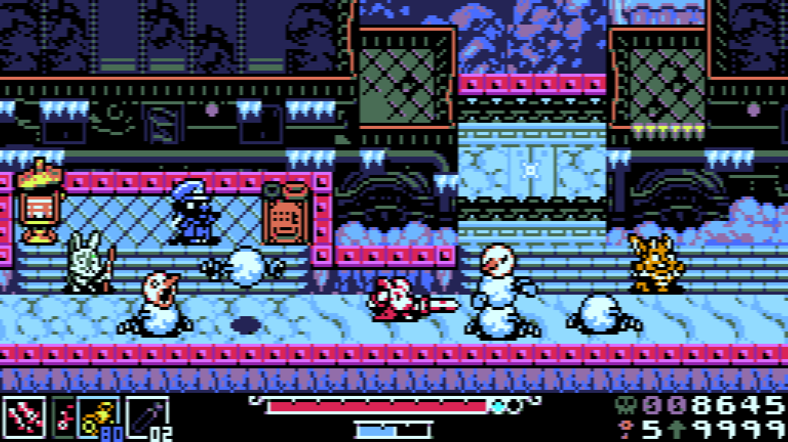
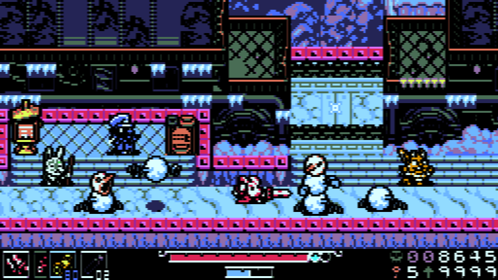

# Цифровий відеовхід процесора Nick

Сигнальні лінії цифрового відеовходу процесора Nick виведені на [порт системної шини](../../../hardware/connections/pinouts-exp.md) (**EC0**-**3** та **EXTC**). Компанія [Enterprise Computers Ltd](../../../companies/enterprise-computers-ltd.md) планувала розробити карту розширення для використання у іграх апаратних спрайтів яка б використовувала дани відеовхід, але через провал продажів це так і не було реалізовано. В даний момент єдиною картою розширення що вміє задіювати даний функціонал є [2dfx](../../../hardware/hv-2dfx.md).

Керування відеовходом можливе двома шляхами:

- Апаратно, зі сторони карти розширення, шляхом активації сигнальної лінії **EXTC** яка вказує відеопроцесору використовувати зовнішні колірні дані замість внутрішніх.
- Програмно, шляхом запису даних у [порт 128](../ports/port128.md) або [системної змінної 38](../exos-variables/exos_var38.md), або виконанням команди Бейсіку [SET PRIORITY](../../../manuals/is-basic-man-en/options/man_vo-priority.md). Це дозволяє змінювати видимість зовнішніх кольорів в залежності від індексу локальної палітри внутрішнього кольору.

## Баг прозорості відеопроцесора

Під час розробки карти [2dfx](../../../hardware/hv-2dfx.md) було виявлено особливість яка виникла, скоріш за все, через брак часу на налагодження усіх режимів роботи. 

Під час активації лінії EXTC перемикання з прозорості на непрозорість відбувається не миттєво а із невеличким запізненням, через що перший непрозорий піксель майже не виводиться. В той же час перемикання з непрозорого пікселя на прозорий проходить нормально.

Приклад некоректного виведення зображення (при умові що чорний колір вважається прозорим):

 

# Програмне керування відеовходом

- `00` — **EC0**–**EC3** вибирають відповідний колір палітри.
- `01` — **EC0**–**EC3** вибирають колір палітри лише тоді, коли внутрішнє зображення генерує кольори з вікна **COL 8**–**COL 15**.
- `10` — **EC0**–**EC3** вибирають колір палітри, якщо внутрішній екран генерує колір з **COL 8**–**COL 15** або якщо зовнішній колір потрапляє у вікно **COL 0**–**COL 7** (при цьому лінія **EC3** в низькому рівні).
- `11` — **EC0**–**EC3** вибирають колір палітри, якщо внутрішній екран генерує колір з **COL 8**–**COL 15** або якщо зовнішній колір потрапляє у вікна **COL 0**–**COL 3** чи **COL 8**–**COL 11** (при цьому лінія **EC2** в низькому рівні).