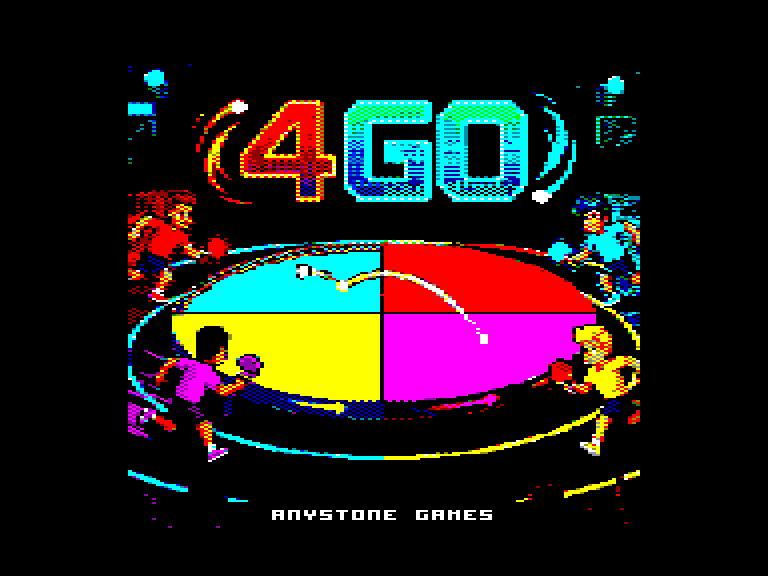
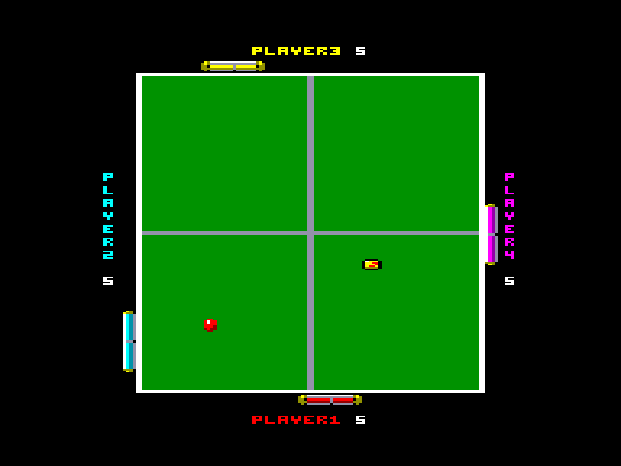
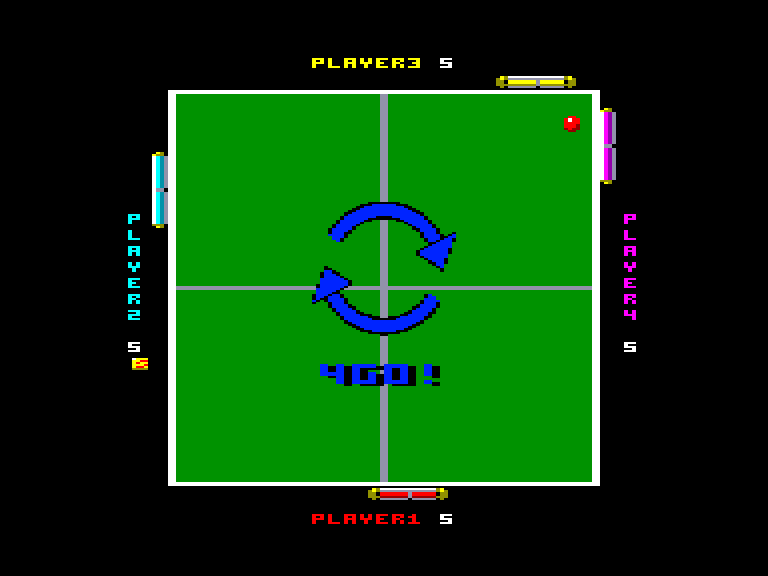
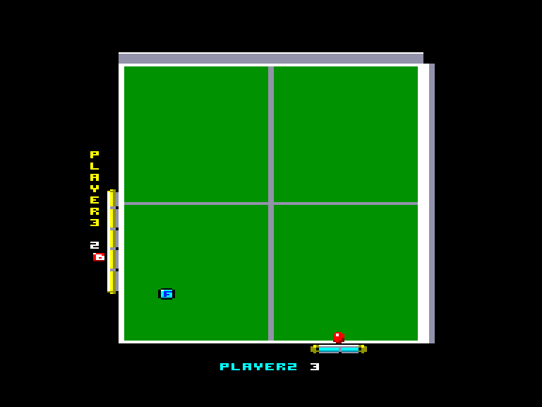

[0-9](../0/games-0.md) - [A](../a/games-a.md) - [B](../b/games-b.md) - [C](../c/games-c.md) - [D](../d/games-d.md) - [E](../e/games-e.md) - [F](../f/games-f.md) - [G](../g/games-g.md) - [H](../h/games-h.md) - [I](../i/games-i.md) - [J](../j/games-j.md) - [K](../k/games-k.md) - [L](../l/games-l.md) - [M](../m/games-m.md) - [N](../n/games-n.md) - [O](../o/games-o.md) - [P](../p/games-p.md) - [Q](../q/games-q.md) - [R](../r/games-r.md) - [S](../s/games-s.md) - [T](../t/games-t.md) - [U](../u/games-u.md) - [V](../v/games-v.md) - [W](../w/games-w.md) - [X](../x/games-x.md) - [Y](../y/games-y.md) - [Z](../z/games-z.md)

Ігри для [Enterprise 64k](../games-ep64.md) - [Enterprise 128k+RAMexp](../games-epramexp.md) - [2dfx](../games-2dfx.md)

Ігри для систем [IS-DOS](../games-is-dos.md) - [SymbOS](../games-symbos.md) - [EDC Windows](../games-edcw.md)

Ігри для емуляторів [ZX Spectrum 48k/128k](../zxemu/games-zxemu.md) - [Amstrad CPC](../cpcemu/games-cpc.md) - [Sinclair ZX81](../zx81emu/games-zx81.md) - [Videoton TVC](../tvcemu/games-tvc.md) - [Commodore VIC-20](../vic20emu/games-vic20.md)

----------

# 4GO

**ID:** 4go

**Жанри:** Аркада, Pong-like

## Примітка

ℹ Хоумбрю-гра.

## Скріншоти

## Запустити у web-емуляторі

<a href="https://epemu.enterpriseforever.com/web/?start=4go" target="_blank" rel="noopener" style="display:inline-block; padding:8px 16px; margin:4px 8px 4px 0; background-color:#2d6cdf; color:#ffffff; text-decoration:none; border-radius:6px; font-weight:bold;">4GO</a>

## Опис

**4GO** (читається як «forgó» \[форґо́\], що на угорській означає «обертання») — party-pong для чотирьох гравців. Чотири ракетки захищають чотири сторони столу, і час від часу всі переходять по колу праворуч чи ліворуч.

## Основна інформація
- **Мови:** Англійська
- **Оригінальна платформа:** Multiplatform
### Загальні системні вимоги
- **Апаратні:** EP128
### Геймплей
- **Керування:** Keyboard, Internal Joy, External Joy 1, External Joy 2, External Joy 3, External Joy 4
- **Кількість гравців:** 1 player, 2 players (versus), 3 players (versus), 4 players (versus)
- **Додаткові теги:** 16-color mode
### Розробка
- **Рік випуску:** 2026
- **Автор:** Róbert Kis
- **Компанія:** AnyStone Games

## Посилання
- [Домашня сторінка](https://anystone.games/?lang=en#en/game-4go-ep)
- [Опис на ep128.hu (угорською)](https://www.ep128.hu/Ep_Games/Leiras/4Go.htm)
- [Опис на programs.enterpriseforever.com (угорською)](https://programs.enterpriseforever.com/en/4go/)
- [Завантажити](https://downloads.anystone.games/4go-ep-com)
- [Завантажити](https://www.ep128.hu/Ep_Games/Prg/4Go.rar)
- [Завантажити](https://programs.enterpriseforever.com/downloads/4go.rar)
- [Easy Load&Play](https://t.me/EP128k_Load_n_Play/1233) *(Telegram-канал Vibrant Waves)*

## Відео

<iframe src="https://www.youtube.com/embed/oeBzkEVb1gc"  
style="width:75%; aspect-ratio:16/9;" allowfullscreen></iframe>

## [Керування](../controllers.md)

`Keyboard`: `W`, `A`, `S`, `D` + `E`  
`Keyboard`: `I`, `J`, `K`, `L` + `U`  
`Internal Joystick` *(як JOY 1)*  
`External Joystick 1`  
`External Joystick 2`  
`External Joystick 3`  
`External Joystick 4`  

`Esc`: вийти з поточної гри у меню

## Детальна інформація

### Системні вимоги  

#### Мінімальні системні вимоги  

Оперативна пам'ять: **128 КБ (або більше)**  

### Геймплей  

Якщо м'яч залишає стіл на вашому боці, ви втрачаєте життя. Усі починають з 5 життями; коли ваші закінчуються, ваш бік перетворюється на стіну, і останній гравець, що залишився, перемагає.  

Кожні 8-18 секунд гра призупиняється, і всі переходять по колу на інше місце (випадковим чином за годинниковою стрілкою або проти годинникової стрілки). З кожним обертанням швидкісь м'яча збільшується.  

Бонуси: час від часу бонус з'являється посередині столу та летить до однієї з ракеток. Вона впливає на того, хто її зловить:  
🅱 (червоний) – ракетка подвійного розміру  
🅼 (фіолетовий) – ракетка половинного розміру  
🅲 (синій) – липка ракетка  
🆂 (жовтий) – повільна ракетка  
🆃 (зелений) – турбо-ракетка  
🅵 (блакитний) – інші ракетки застигають на кілька секунд  

Налаштування гри: кожен із 4 гравців може керуватись комп'ютером (3 рівні складності), джойстиком або клавіатурою, а імена можна редагувати.