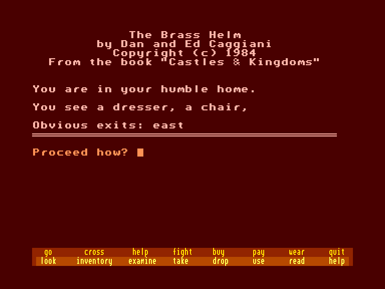
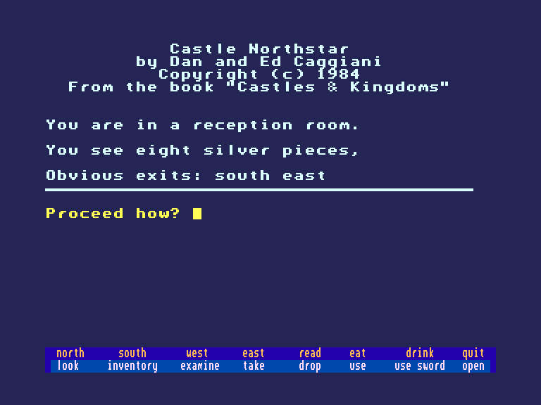
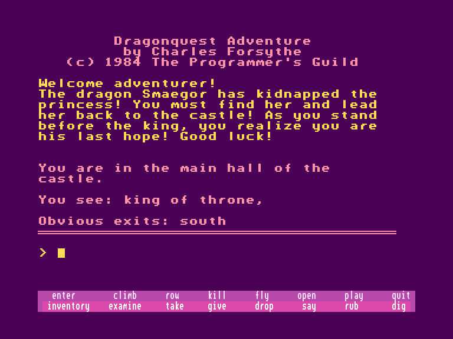
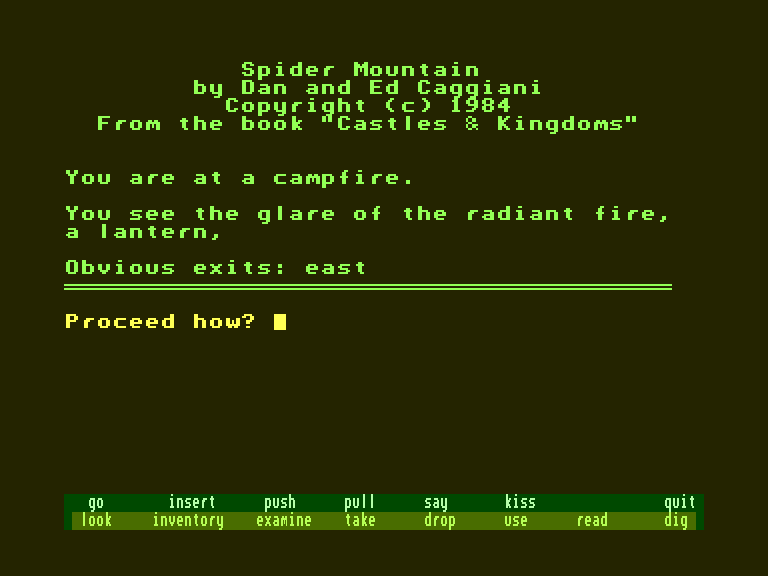

[0-9](../0/games-0.md) - [A](../a/games-a.md) - [B](../b/games-b.md) - [C](../c/games-c.md) - [D](../d/games-d.md) - [E](../e/games-e.md) - [F](../f/games-f.md) - [G](../g/games-g.md) - [H](../h/games-h.md) - [I](../i/games-i.md) - [J](../j/games-j.md) - [K](../k/games-k.md) - [L](../l/games-l.md) - [M](../m/games-m.md) - [N](../n/games-n.md) - [O](../o/games-o.md) - [P](../p/games-p.md) - [Q](../q/games-q.md) - [R](../r/games-r.md) - [S](../s/games-s.md) - [T](../t/games-t.md) - [U](../u/games-u.md) - [V](../v/games-v.md) - [W](../w/games-w.md) - [X](../x/games-x.md) - [Y](../y/games-y.md) - [Z](../z/games-z.md)

Ігри для [Enterprise 64k](../games-ep64.md) - [Enterprise 128k+RAMexp](../games-epramexp.md) - [2dfx](../games-2dfx.md)

Ігри для систем [IS-DOS](../games-is-dos.md) - [SymbOS](../games-symbos.md) - [EDC Windows](../games-edcw.md)

Ігри для емуляторів [ZX Spectrum 48k/128k](../zxemu/games-zxemu.md) - [Amstrad CPC](../cpcemu/games-cpc.md) - [Sinclair ZX81](../zx81emu/games-zx81.md) - [Videoton TVC](../tvcemu/games-tvc.md) - [Commodore VIC-20](../vic20emu/games-vic20.md)

----------

# Castles & Kingdoms

**ID:** castles-and-kingdoms-bas

**Жанри:** Текстова пригода

## Примітка

ℹ Сучасна неофіційна конверсія.

## Скріншоти

## Запустити у web-емуляторі

<a href="https://epemu.enterpriseforever.com/web/?start=castles-kingdoms" target="_blank" rel="noopener" style="display:inline-block; padding:8px 16px; margin:4px 8px 4px 0; background-color:#2d6cdf; color:#ffffff; text-decoration:none; border-radius:6px; font-weight:bold;">Castles & Kingdoms</a>

## Опис

Збірник з 15 текстових пригод, які були опубліковані в книзі [Castles & Kingdoms](https://archive.org/details/castles-and-kingdoms-adventures-for-your-commodore-64)  

1.[The Brass Helm](../b/brass-helm-bas.md) (початкова гра яка веде до інших)  
2.[Dragonquest](../d/dragonquest-adv-bas.md)  
3.[A Tale of Spider Mountain](../t/tale-of-spider-mountain-bas.md)  
4.[Thunder Mountain Passage](../t/thunder-mountain-passage-bas.md)  
5.[Stargate](../s/stargate-bas.md)  
6.[Castle Northstar](castle-northstar-bas.md)  
7.[Deadly Dungeon](../d/deadly-dungeon-bas.md)  
8.[The Temple of Vishtari](../t/temple-of-vishtari-bas.md)  
9.[Tower of Fear](../t/tower-of-fear-bas.md)  
10.[Werewolf Wars](../w/werewolf-wars-bas.md)  
11.[Gauntlet of Death](../g/gauntlet-of-death-bas.md)  
12.[Firekeep](../f/firekeep-bas.md)  
13.[Revenge of Balrog](../r/revenge-of-balrog-bas.md)  
14.[The Fortress at Time's End](../f/fortress-at-times-end-bas.md)  
15.[The Blue-Eyed Thief](../b/blueeyed-thief-bas.md)

## Основна інформація
- **Мови:** Англійська
### Загальні системні вимоги
- **Програмні:** IS-Basic
### Геймплей
- **Керування:** Keyboard
- **Кількість гравців:** 1 player
### Розробка
- **Рік випуску:** 1985

## Посилання
- [Опис на ep128.hu (угорською)](http://www.ep128.hu/Ep_Games/Leiras/Castles_and_Kingdoms.htm)
- [Опис на programs.enterpriseforever.com (угорською)](https://programs.enterpriseforever.com/en/castles-kingdoms/)
- [Завантажити](http://www.ep128.hu/Ep_Games/Prg/Castles_and_Kingdoms.rar)
- [Завантажити](https://programs.enterpriseforever.com/downloads/castles_and_kingdoms.rar)

