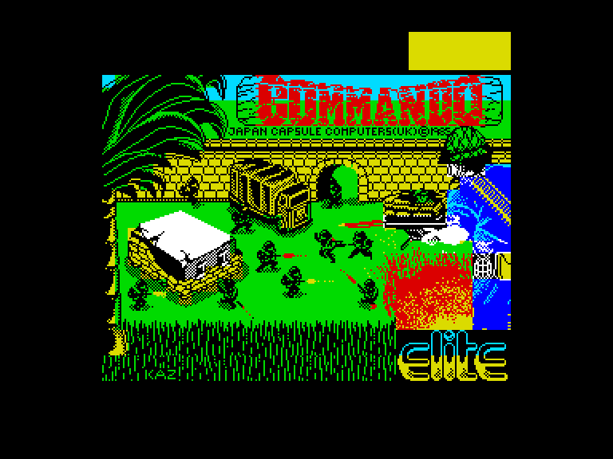
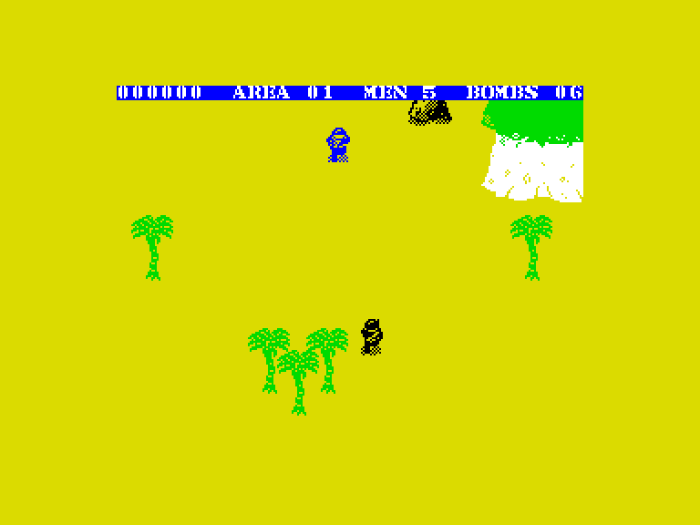
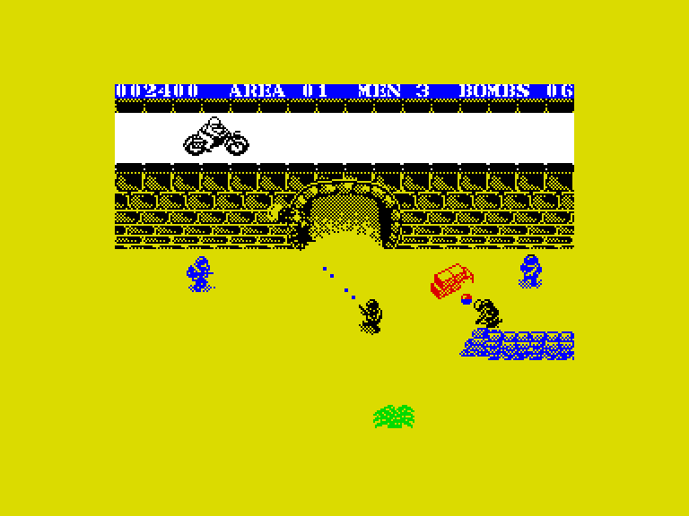
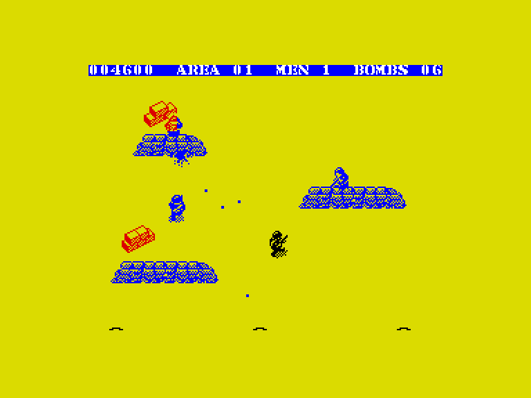

[0-9](../0/games-0.md) - [A](../a/games-a.md) - [B](../b/games-b.md) - [C](../c/games-c.md) - [D](../d/games-d.md) - [E](../e/games-e.md) - [F](../f/games-f.md) - [G](../g/games-g.md) - [H](../h/games-h.md) - [I](../i/games-i.md) - [J](../j/games-j.md) - [K](../k/games-k.md) - [L](../l/games-l.md) - [M](../m/games-m.md) - [N](../n/games-n.md) - [O](../o/games-o.md) - [P](../p/games-p.md) - [Q](../q/games-q.md) - [R](../r/games-r.md) - [S](../s/games-s.md) - [T](../t/games-t.md) - [U](../u/games-u.md) - [V](../v/games-v.md) - [W](../w/games-w.md) - [X](../x/games-x.md) - [Y](../y/games-y.md) - [Z](../z/games-z.md)

Ігри для [Enterprise 64k](../games-ep64.md) - [Enterprise 128k+RAMexp](../games-epramexp.md) - [2dfx](../games-2dfx.md)

Ігри для систем [IS-DOS](../games-is-dos.md) - [SymbOS](../games-symbos.md) - [EDC Windows](../games-edcw.md)

Ігри для емуляторів [ZX Spectrum 48k/128k](../zxemu/games-zxemu.md) - [Amstrad CPC](../cpcemu/games-cpc.md) - [Sinclair ZX81](../zx81emu/games-zx81.md) - [Videoton TVC](../tvcemu/games-tvc.md) - [Commodore VIC-20](../vic20emu/games-vic20.md)

----------

# Commando

**ID:** commando-zx

**Жанри:** Екшн

## Примітка

ℹ Стара неофіційна конверсія з платформи ZX Spectrum.  
(краще використовувати сучасний порт з Amstrad CPC)

## Скріншоти

## Запустити у web-емуляторі

<a href="https://epemu.enterpriseforever.com/web/?start=commando&v=commando-attus" target="_blank" rel="noopener" style="display:inline-block; padding:8px 16px; margin:4px 8px 4px 0; background-color:#2d6cdf; color:#ffffff; text-decoration:none; border-radius:6px; font-weight:bold;">Commando (Attus)</a>
<a href="https://epemu.enterpriseforever.com/web/?start=commando&v=commando-bamsoft" target="_blank" rel="noopener" style="display:inline-block; padding:8px 16px; margin:4px 8px 4px 0; background-color:#2d6cdf; color:#ffffff; text-decoration:none; border-radius:6px; font-weight:bold;">Commando (BAM)</a>

## Опис

Ви — Супер Джо, елітний боєць вісімдесятих (!), який всупереч усім шансам биється проти наступаючих сил заколотників. Озброєний лише кулеметом M60 та шістьма ручними гранатами, ви ведете свій хрестовий похід наодинці, пробиваючись углиб ворожої території.  

Мінометні міни, гранати та динамітні шашки дощем сиплються з неба й вибухають навколо вас. Ворожі кулі свистять з усіх боків, а окопи, кручі та озера перегороджують вам шлях.  

Війська повстанців виринають із печер, укріплень і бронетранспортерів, аби зупинити ваш просув. Ви не повинні знати милосердя. Ви не маєте права відступати. Ви мусите прориватися все далі й далі углиб ворожих позицій, підбираючи запаси гранат на розгромлених аванпостах, аж поки не досягнете своєї фінальної мети — фортеці ворога.

## Основна інформація
- **Мови:** Англійська
- **Оригінальна платформа:** ZX Spectrum
### Геймплей
- **Додаткові теги:** Attribute mode
### Розробка
- **Рік випуску:** 1985

## Посилання
- [Опис на ep128.hu (угорською)](http://www.ep128.hu/Games/Commando.htm)
- [Опис на programs.enterpriseforever.com (угорською)](https://programs.enterpriseforever.com/en/commando/#commando-zx-spectrum)
- [Інформація про оригінальну версію](https://spectrumcomputing.co.uk/entry/9325)
- [Завантажити](http://www.ep128.hu/Ep_Games/Prg/Commando.rar)
- [Завантажити](https://programs.enterpriseforever.com/downloads/commando.rar)

