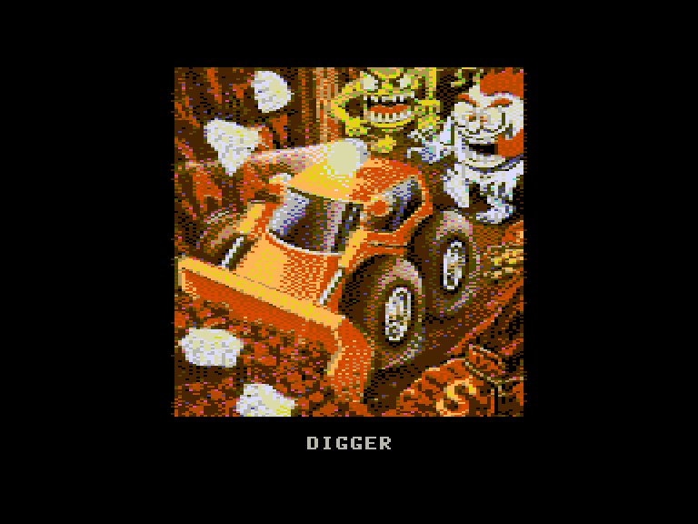
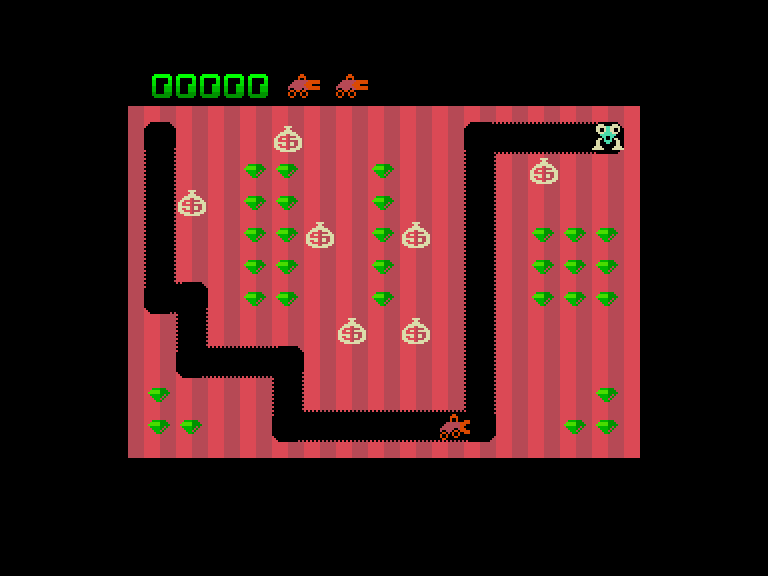
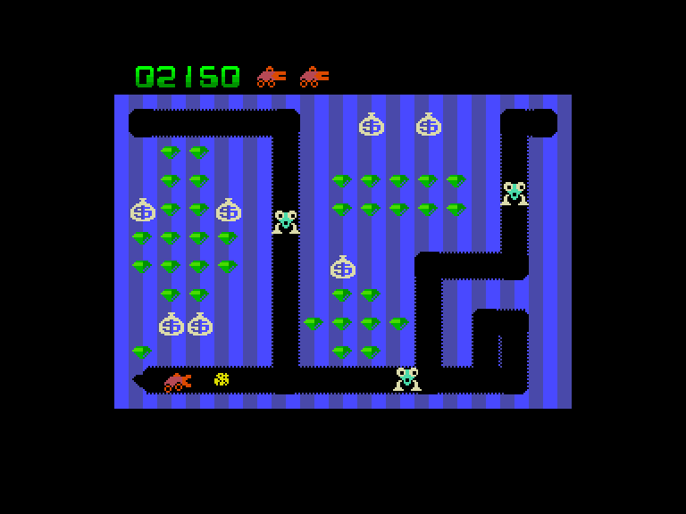
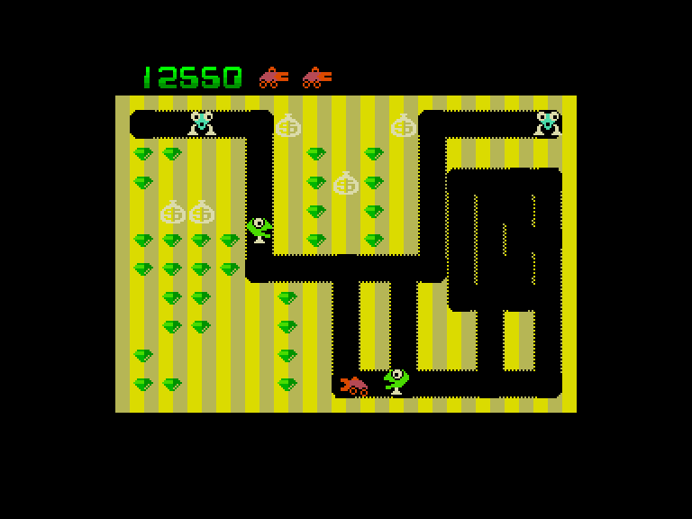

[0-9](../0/games-0.md) - [A](../a/games-a.md) - [B](../b/games-b.md) - [C](../c/games-c.md) - [D](../d/games-d.md) - [E](../e/games-e.md) - [F](../f/games-f.md) - [G](../g/games-g.md) - [H](../h/games-h.md) - [I](../i/games-i.md) - [J](../j/games-j.md) - [K](../k/games-k.md) - [L](../l/games-l.md) - [M](../m/games-m.md) - [N](../n/games-n.md) - [O](../o/games-o.md) - [P](../p/games-p.md) - [Q](../q/games-q.md) - [R](../r/games-r.md) - [S](../s/games-s.md) - [T](../t/games-t.md) - [U](../u/games-u.md) - [V](../v/games-v.md) - [W](../w/games-w.md) - [X](../x/games-x.md) - [Y](../y/games-y.md) - [Z](../z/games-z.md)

Ігри для [Enterprise 64k](../games-ep64.md) - [Enterprise 128k+RAMexp](../games-epramexp.md) - [2dfx](../games-2dfx.md)

Ігри для систем [IS-DOS](../games-is-dos.md) - [SymbOS](../games-symbos.md) - [EDC Windows](../games-edcw.md)

Ігри для емуляторів [ZX Spectrum 48k/128k](../zxemu/games-zxemu.md) - [Amstrad CPC](../cpcemu/games-cpc.md) - [Sinclair ZX81](../zx81emu/games-zx81.md) - [Videoton TVC](../tvcemu/games-tvc.md) - [Commodore VIC-20](../vic20emu/games-vic20.md)

----------

# Digger

**ID:** digger-coleco

**Жанри:** Аркада, Екшн

## Примітка

ℹ Сучасна неофіційна конверсія з платформи ColecoVision.

## Скріншоти

## Опис

Приєднуйтесь до пошуків захованих скарбів — сяючого золота та блискучих смарагдів. Сідайте за кермо вашого механізованого «Digger-мобіля» із клацаючими передніми щелепами. Проривайте лабіринти довільної форми, перехитріть витрішкуватих Ноббінів та поспішайте зібрати коштовні камені. Покладайтеся на свій розум — він вам обов'язково знадобиться!

## Основна інформація
- **Мови:** Англійська
- **Оригінальна платформа:** ColecoVision
### Загальні системні вимоги
- **Апаратні:** 2dfx, EP128
### Геймплей
- **Керування:** Keyboard, Internal Joy, External Joy 1
- **Кількість гравців:** 1 player
- **Додаткові теги:** Attribute mode
### Розробка
- **Рік випуску:** 1983, 2015
- **Автор:** Mystery Man
- **Компанія:** Windmill Software Inc.

## Посилання
- [Easy Load&Play](https://t.me/EP128k_Load_n_Play/1225) *(Telegram-канал Vibrant Waves)*

## Відео

<iframe src="https://www.youtube.com/embed/NdzeQbBKZwY"  
style="width:75%; aspect-ratio:16/9;" allowfullscreen></iframe>

- [Відео](https://www.youtube.com/watch?v=EESasT6nhxc)
- [Відео](https://www.youtube.com/watch?v=XsocUHBlsjk)

## [Керування](../controllers.md)

`Keyboard`  
`Internal Joystick`  
`External Joystick 1`  

`F6`: вимкн./увімкн. звукові ефекти  
`F7`: вимкн./увімкн. музику  
`Hold`/`Pause`: пауза

## Детальна інформація

### Системні вимоги  

#### Мінімальні системні вимоги  
Оперативна пам'ять: **128 КБ (або більше)**  
Апаратні розширення: **2dfx**  

### Геймплей  

Головна мета на кожному рівні — зібрати всі наявні на ньому смарагди (або знищити усіх монстрів), адже тільки тоді можна буде перейти на наступний рівень. Є два типи ворогів — Nobbins та Hobbins. Nobbins вміють пересуватись лише по існуючих проходах і на деякий час перетворюватись на Hobbins (які пересуваються швидше і вміють прокопувати нові тонелі).  

Знищувати ворогів можна двома способами. Перший — стріляти в них, але слід пам'ятати, що вистрілити в конкретний момент часу машина може лише один раз (перезарядка займає деякий час). Другий спосіб — розрити землю під мішками із золотом, що трапляються на шляху, (або виштовхнути їх у вільний прохід) аби вони впали вниз і розчавили ворогів. Крім того, у грі можна збирати рідкісні бонуси-вишеньки (їхня поява залежить від кількості знищених монстрів на цьому рівні), завдяки яким наша машина може деякий час жерти і самих монстрів.  

Після отримання двадцяти тисяч очок вам дають додаткове життя.