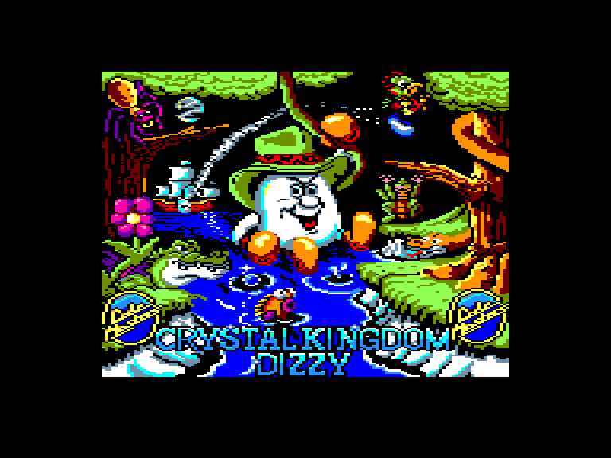
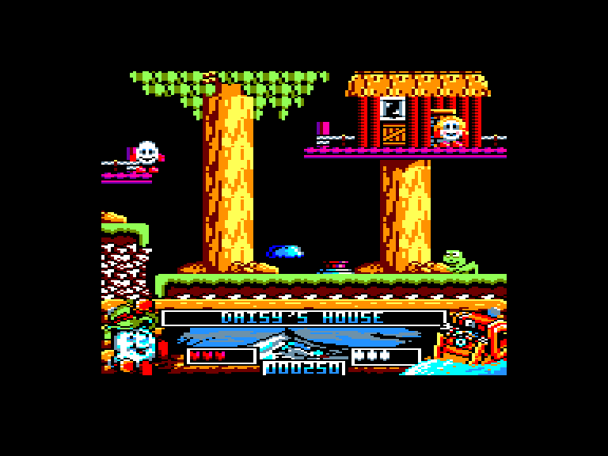
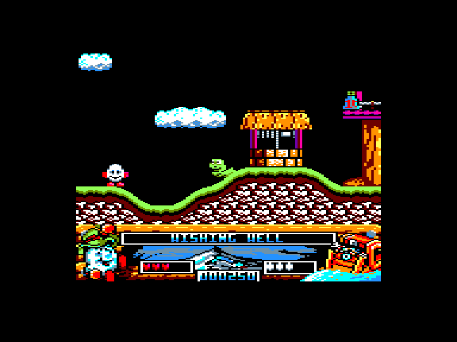
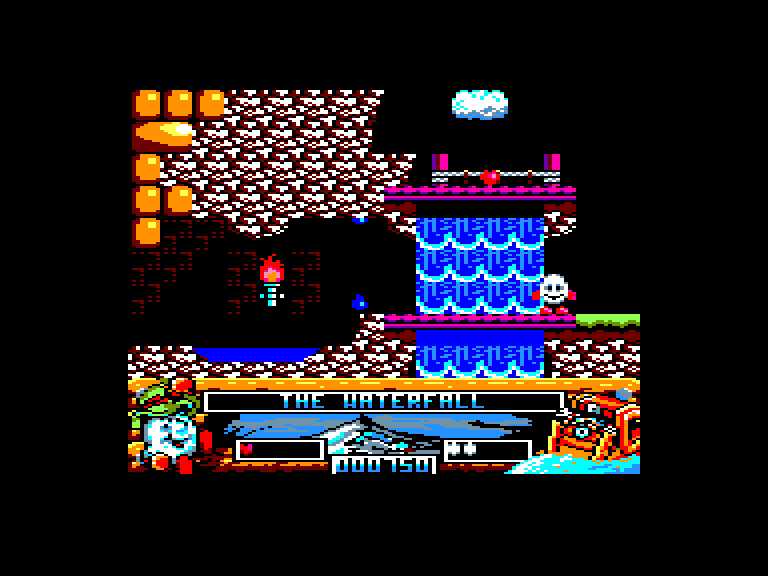

[0-9](../0/games-0.md) - [A](../a/games-a.md) - [B](../b/games-b.md) - [C](../c/games-c.md) - [D](../d/games-d.md) - [E](../e/games-e.md) - [F](../f/games-f.md) - [G](../g/games-g.md) - [H](../h/games-h.md) - [I](../i/games-i.md) - [J](../j/games-j.md) - [K](../k/games-k.md) - [L](../l/games-l.md) - [M](../m/games-m.md) - [N](../n/games-n.md) - [O](../o/games-o.md) - [P](../p/games-p.md) - [Q](../q/games-q.md) - [R](../r/games-r.md) - [S](../s/games-s.md) - [T](../t/games-t.md) - [U](../u/games-u.md) - [V](../v/games-v.md) - [W](../w/games-w.md) - [X](../x/games-x.md) - [Y](../y/games-y.md) - [Z](../z/games-z.md)

Ігри для [Enterprise 64k](../games-ep64.md) - [Enterprise 128k+RAMexp](../games-epramexp.md) - [2dfx](../games-2dfx.md)

Ігри для систем [IS-DOS](../games-is-dos.md) - [SymbOS](../games-symbos.md) - [EDC Windows](../games-edcw.md)

Ігри для емуляторів [ZX Spectrum 48k/128k](../zxemu/games-zxemu.md) - [Amstrad CPC](../cpcemu/games-cpc.md) - [Sinclair ZX81](../zx81emu/games-zx81.md) - [Videoton TVC](../tvcemu/games-tvc.md) - [Commodore VIC-20](../vic20emu/games-vic20.md)

----------

# Crystal Kingdom Dizzy

**Альтернативні назви:**
 - Dizzy 7

**ID:** dizzy7-cpc

**Жанри:** Пригодницька, Платформер

## Примітка

Unofficial conversion

## Скріншоти

## Запустити у web-емуляторі

<a href="https://epemu.enterpriseforever.com/web/?start=dizzy-7" target="_blank" rel="noopener" style="display:inline-block; padding:8px 16px; margin:4px 8px 4px 0; background-color:#2d6cdf; color:#ffffff; text-decoration:none; border-radius:6px; font-weight:bold;">Crystal Kingdom Dizzy</a>

## Опис

(temporary description generated by AI [ChatGPT])

**Опис гри: Dizzy 7**  
Dizzy 7 – це пригодницька гра, в якій гравці беруть на себе роль Діззі, наполовину яйця, наполовину курки. Гра відзначається яскравою графікою і захоплюючим ігровим процесом, що дозволяє досліджувати різноманітні локації Кришталевого Королівства.

**Правила гри:**  
1. Гравець може налаштувати управління за допомогою клавіатури або джойстика.
2. Основні команди:  
   - **P** – призупинити гру (продовження: натисніть 'вогонь' для підбору предметів).  
   - **Q** – вийти з гри.
3. Після завантаження гри можна активувати різні чіти:  
   - **'M'** – безсмертя.  
   - **'.'** – безмежна енергія.  
   - **','** – енергія витрачається лише на кожну другу травму.
4. У меню налаштувань управління можна активувати режим невразливості, одночасно натиснувши клавіші T, U, R, B, і O, що буде позначено білою рамкою.

Гра пропонує гравцям захоплюючий досвід дослідження та вирішення головоломок у чарівному світі!

## Основна інформація
- **Мови:** Англійська
- **Оригінальна платформа:** Amstrad CPC
### Геймплей
- **Кількість гравців:** 1 player
- **Додаткові теги:** 16-color mode
### Розробка
- **Рік випуску:** 1992

## Посилання
- [Домашня сторінка](https://yolkfolk.com/games/crystal-kingdom-dizzy/)
- [Опис на ep128.hu (угорською)](http://www.ep128.hu/Ep_Games/Leiras/Dizzy_7.htm)
- [Опис на programs.enterpriseforever.com (угорською)](https://programs.enterpriseforever.com/en/dizzy-7/)
- [Інформація про оригінальну версію](https://www.cpc-power.com/index.php?page=detail&num=642)
- [Завантажити](http://www.ep128.hu/Ep_Games/Prg/Dizzy7.rar)
- [Завантажити](https://programs.enterpriseforever.com/downloads/dizzy7.rar)

