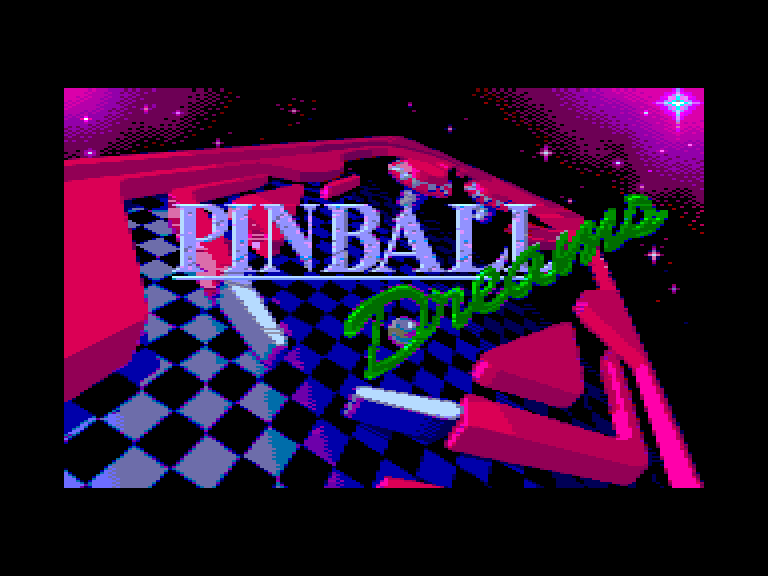
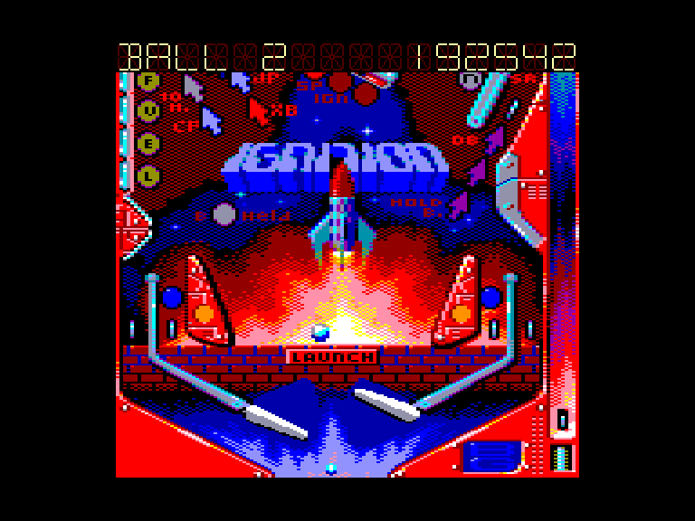
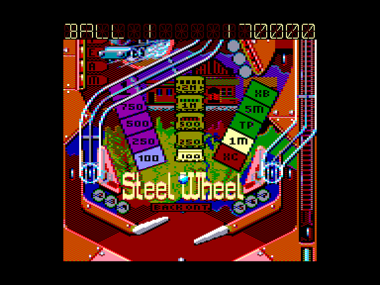
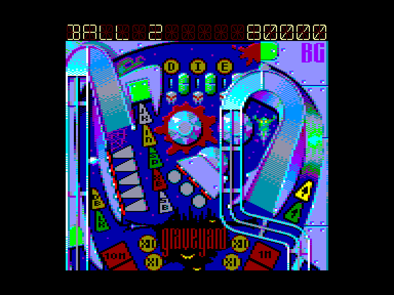

[0-9](../0/games-0.md) - [A](../a/games-a.md) - [B](../b/games-b.md) - [C](../c/games-c.md) - [D](../d/games-d.md) - [E](../e/games-e.md) - [F](../f/games-f.md) - [G](../g/games-g.md) - [H](../h/games-h.md) - [I](../i/games-i.md) - [J](../j/games-j.md) - [K](../k/games-k.md) - [L](../l/games-l.md) - [M](../m/games-m.md) - [N](../n/games-n.md) - [O](../o/games-o.md) - [P](../p/games-p.md) - [Q](../q/games-q.md) - [R](../r/games-r.md) - [S](../s/games-s.md) - [T](../t/games-t.md) - [U](../u/games-u.md) - [V](../v/games-v.md) - [W](../w/games-w.md) - [X](../x/games-x.md) - [Y](../y/games-y.md) - [Z](../z/games-z.md)

Ігри для [Enterprise 64k](../games-ep64.md) - [Enterprise 128k+RAMexp](../games-epramexp.md) - [2dfx](../games-2dfx.md)

Ігри для систем [IS-DOS](../games-is-dos.md) - [SymbOS](../games-symbos.md) - [EDC Windows](../games-edcw.md)

Ігри для емуляторів [ZX Spectrum 48k/128k](../zxemu/games-zxemu.md) - [Amstrad CPC](../cpcemu/games-cpc.md) - [Sinclair ZX81](../zx81emu/games-zx81.md) - [Videoton TVC](../tvcemu/games-tvc.md) - [Commodore VIC-20](../vic20emu/games-vic20.md)

----------

# Pinball Dreams

**ID:** pinball-dreams-cpc

**Жанри:** Пінбол

## Примітка

ℹ Сучасна неофіційна конверсія з платформи Amstrad CPC	.

## Скріншоти

## Опис

Перша гра в серії симуляторів пінболу від 21st Century та Digital Illusions, що містить чотири столи на різну тематику: Дикий Захід для Steel Wheel, космічні ракети для Ignition, кладовище з привидами для Nightmare та поп-музика для Beat Box.

## Основна інформація
- **Мови:** Англійська
- **Оригінальна платформа:** Amstrad CPC
### Загальні системні вимоги
- **Апаратні:** EP128
### Геймплей
- **Керування:** Keyboard
- **Кількість гравців:** 1 player
- **Додаткові теги:** 16-color mode
### Розробка
- **Рік випуску:** 2019
- **Автор:** Rhino, Mac, Toni Galvez, Jonah Tasteful Mr Ship, Raft, John McKlain, Arnoldemu
- **Компанія:** Batman group

## Посилання
- [Інформація про оригінальну версію](https://www.cpc-power.com/index.php?page=detail&num=16736)
- [Easy Load&Play](https://t.me/EP128k_Load_n_Play/1237) *(Telegram-канал Vibrant Waves)*

## [Керування](../controllers.md)

**Головне меню:**  
`1`-`4` або `F1`-`F4`: вибір столу для гри  

**Гра:**  
`Enter` або `IntJoy Down` (утримувати): відтягнути пружину (відпустіть, щоб запустити кульку)  
`Ctrl`/`Left Shift`/`Z`(або `Y` на BRD-клавіатурі): лівий фліпер (перемикання лампочок)  
`Alt`/`Right Shift`/`/`(або `-` на BRD-клавіатурі): правий фліпер (перемикання лампочок)  
`Space`: поштовх столу (два швидких поштовха: TILT!)  
`H`: вимкн./увімкнути HUD (повноекранний стіл)  
`M`: вимкн./увімкнути музику  
`F7`: вимкн./увімкнути вбудований спікер  
`Esc`: повернутись до вибору столів (у головне меню)

## Детальна інформація

### Системні вимоги  

#### Мінімальні системні вимоги  

Оперативна пам'ять: **128 КБ (або більше)**  

#### Рекомендовані системні вимоги  

Оперативна пам'ять: **128 КБ (або більше)**  
Системні розширення: EXDOS  

### Геймплей  

Для перегляду усіх тонкощів гри зверніться до посібника для оригінальної версії з Amstrad CPC.