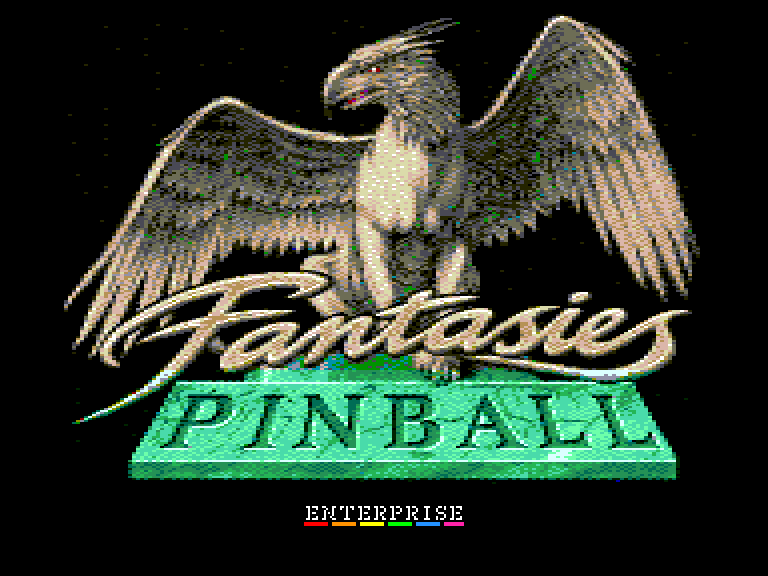
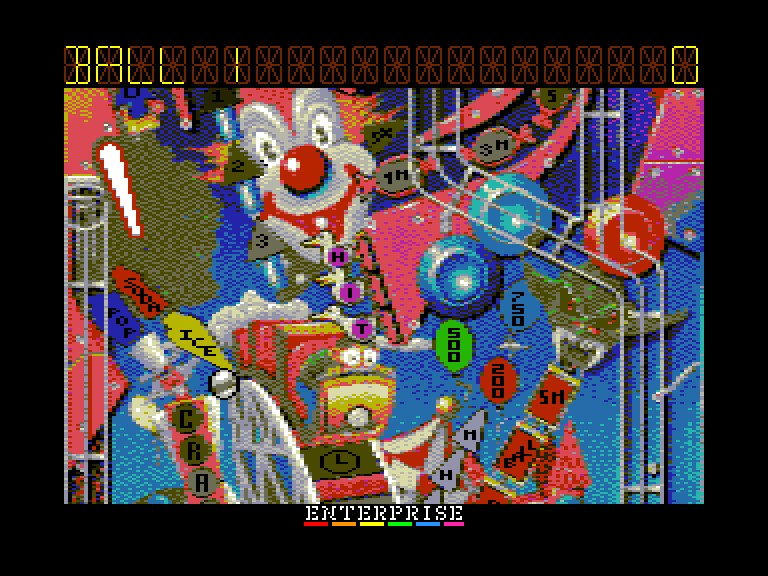
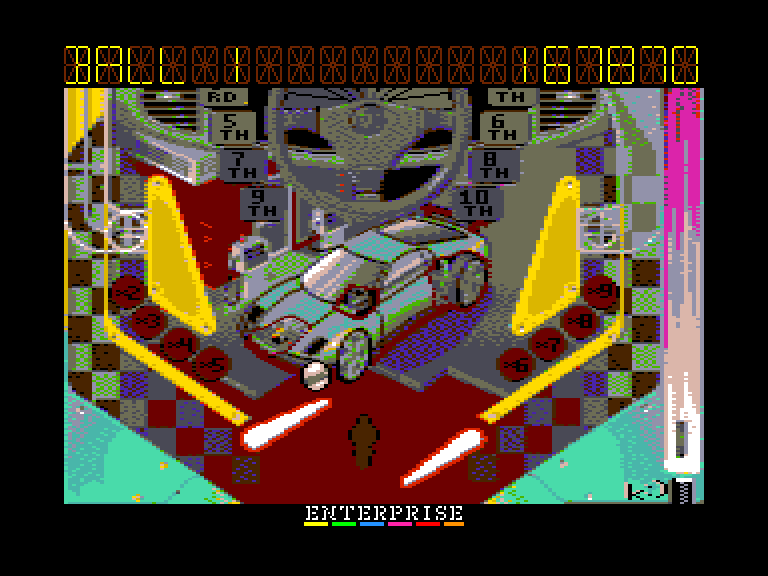
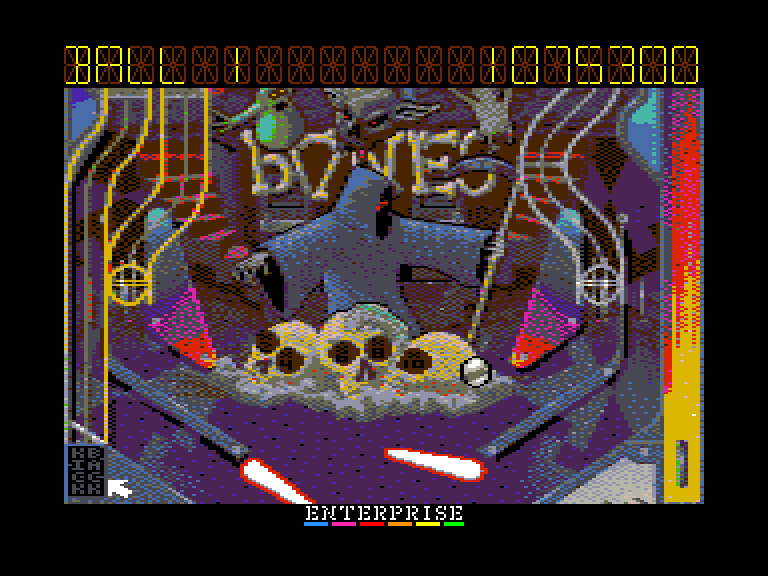

[0-9](../0/games-0.md) - [A](../a/games-a.md) - [B](../b/games-b.md) - [C](../c/games-c.md) - [D](../d/games-d.md) - [E](../e/games-e.md) - [F](../f/games-f.md) - [G](../g/games-g.md) - [H](../h/games-h.md) - [I](../i/games-i.md) - [J](../j/games-j.md) - [K](../k/games-k.md) - [L](../l/games-l.md) - [M](../m/games-m.md) - [N](../n/games-n.md) - [O](../o/games-o.md) - [P](../p/games-p.md) - [Q](../q/games-q.md) - [R](../r/games-r.md) - [S](../s/games-s.md) - [T](../t/games-t.md) - [U](../u/games-u.md) - [V](../v/games-v.md) - [W](../w/games-w.md) - [X](../x/games-x.md) - [Y](../y/games-y.md) - [Z](../z/games-z.md)

Ігри для [Enterprise 64k](../games-ep64.md) - [Enterprise 128k+RAMexp](../games-epramexp.md) - [2dfx](../games-2dfx.md)

Ігри для систем [IS-DOS](../games-is-dos.md) - [SymbOS](../games-symbos.md) - [EDC Windows](../games-edcw.md)

Ігри для емуляторів [ZX Spectrum 48k/128k](../zxemu/games-zxemu.md) - [Amstrad CPC](../cpcemu/games-cpc.md) - [Sinclair ZX81](../zx81emu/games-zx81.md) - [Videoton TVC](../tvcemu/games-tvc.md) - [Commodore VIC-20](../vic20emu/games-vic20.md)

----------

# Pinball Fantasies

**ID:** pinball-fantasies-pc

**Жанри:** Пінбол

## Примітка

ℹ Сучасна неофіційна конверсія з платформи PC.

## Скріншоти

## Опис

Пінбол із реалістичною фізикою, мультиплеєром та таблицею рекордів. Назви столів: Partyland, Speed Devils, Billion Dollar Gameshow та Stones 'n' Bones, і вони тематично пов'язані з парком атракціонів, гоночними автомобілями, дешевим телешоу та цвинтарем. Кожен із них має безліч рамп, комбо, світлових послідовностей і мішеней для влучання.

## Основна інформація
- **Мови:** Англійська
- **Оригінальна платформа:** PC
### Загальні системні вимоги
- **Апаратні:** EP128
### Геймплей
- **Керування:** Keyboard
- **Кількість гравців:** 1 player, 2 players (alternate), 3 players (alternate), 4 players (alternate), 5 players (alternate), 6 players (alternate), 7 players (alternate), 8 players (alternate)
- **Додаткові теги:** 16-color mode
### Розробка
- **Рік випуску:** 1992
- **Автор:** Andreas Axelsson, Olof Gustafsson, Markus Nyström, Fredrik Liliegren, Barry Simpson, Ulf Mandorff
- **Компанія:** Digital Illusions

## Відео

<iframe src="https://www.youtube.com/embed/PDr3oGVYtR8"  
style="width:75%; aspect-ratio:16/9;" allowfullscreen></iframe>

## [Керування](../controllers.md)

`Keyboard`  

**Налаштування гри:**  
`F1`-`F8`: вибір кількості гравців (1-8)  
`3`: 3 кульки  
`5`: 5 кульок  
`Esc`: вихід у меню  

**Гра:**  
`Down`: відтягнути пружину (відпустіть, щоб запустити кульку)  
`LeftShift`/`RightShift`: керування фліперами (та перемикання деяких лампочок)  
`Space`: поштовх столу  
`Esc`: вихід з поточної гри

