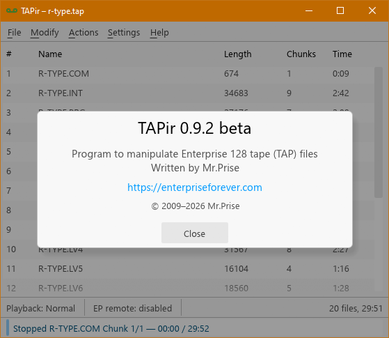

# TAPir

Автор: [Lukács Árpád](../peoples/community/mrprise.md) (Mr.Prise)  
Платформа: Win32, Linux*  
Рік: 2009-2026

Програма створена для роботи з образами стрічоку у форматах TAP та WAV. Може використовуватись у якості віртуального магнітофону (з підтримкою керованої паузи)

Підтримує наступні формати:

- [TAP](../programming/tips-hints/fileformats/fmt_tap-tapir.md) (TAPir): образ стрічки  
- [TAP](../programming/tips-hints/fileformats/fmt_tap-epte.md) (EPTE): образ стрічки (імпорт/експорт)  
- WAV: аудіообраз стрічки у стандартному форматі (генерація та розпізнавання записів)

[Тема на форумі](https://enterpriseforever.com/emulatorok/tapir).

[Стара версія програми (v0.2)](http://ep128.hu/Emu/TAPir.rar)