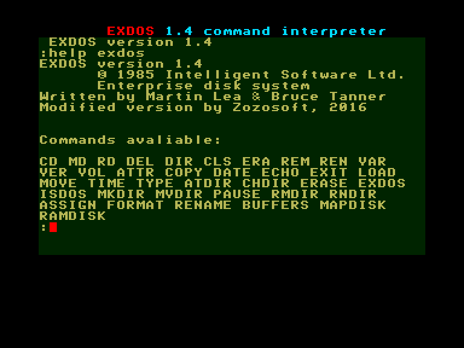

# EXDOS (Enterprise eXpandable Disk Operating System)

[Опис апаратної частини EXDOS](../hardware/hd-exdos.md)

----

# Документація

📔 [Офіційний посібник користувача EXDOS](../manuals/ss-exdos-manual-en.md) (англійською)  
📔 [Посібник користувача EXDOS 3.0](../manuals/exdos30-man/exdos30-main.md)

## Cпецифікація (попередня версія)

Документи відносяться до предрелізних версій продукту і тому деякі частини будуть відрізнятись від того що увійшло у фінальну версію.

[Contents](http://enterprise.iko.hu/technical/EXDOS_Enterprise-Disk-Software_contents.pdf)  
[EXDOS System overview](http://enterprise.iko.hu/technical/PER-1-1_EXDOS_System_Overview.pdf)  
[EXDOS DISKIO Specifications](http://enterprise.iko.hu/technical/PER-2-3_EXDOS_DISKIO_Specification.pdf)  
[EXDOS Unit Handler Specifications](http://enterprise.iko.hu/technical/PER-3-2_EXDOS_Unit_Handler_Specification.pdf)  
[DISKIO and UNITH implementation notes]()  
[EXDOS System Specifications](http://enterprise.iko.hu/technical/PER-5-2_EXDOS_System_Specification.pdf)  

# Історія версій

- EXDOS 0.3 була ранньою розробницькою версією.
- EXDOS 1.0, 1.1 та 1.2 були оригінальними версіями [Intelligent Software Ltd](../companies/intelligent-software-ltd.md), випущеними в 1985 році.
- EXDOS 1.3 (англійсько-німецька версія) була створена компанією [Intelligent Software Ltd](../companies/intelligent-software-ltd.md) у 1985 році для [Enterprise Computers GmbH](../companies/enterprise-computers-gmbh.md).
- EXDOS 1.4 була створена [Zozosoft](../peoples/community/zozosoft.md) шляхом масивного бінарного патчингу версії 1.3.
- EXDOS 2.0 була створена [Enterprise Computers Ltd](../companies/enterprise-computers-ltd.md) у 1985 році на базі версії 1.0 для [прототипу 911](../hardware/hm-911.md) (який так і не вийшов); вона містила лише таймінги дисковода, змінені під 6 МГц Z80.
- EXDOS 2.1 була створена [Zozosoft](../peoples/community/zozosoft.md) як англійсько-німецька версія 2.0 для так і не випущеного [прототипу 911](../hardware/hm-911.md).
- EXDOS 3.0 базується на оригінальному вихідному коді 1.3, але містить усю функціональність 1.4 та таймінги, незалежні від швидкості процесора. Версія для SD-карт містить [SDEXT 3.0](sd-sdext.md) для SD-карт, а також [IDE 3.0](sd-ide.md) для IDE-накопичувачів; вони підтримують 32-бітні номери секторів.

# Посилання на зовнішні ресурси

[http://ep.homeserver.hu/Dokumentacio/Konyvek/EXDOS/EXDOSeng.htm](http://ep.homeserver.hu/Dokumentacio/Konyvek/EXDOS/EXDOSeng.htm)